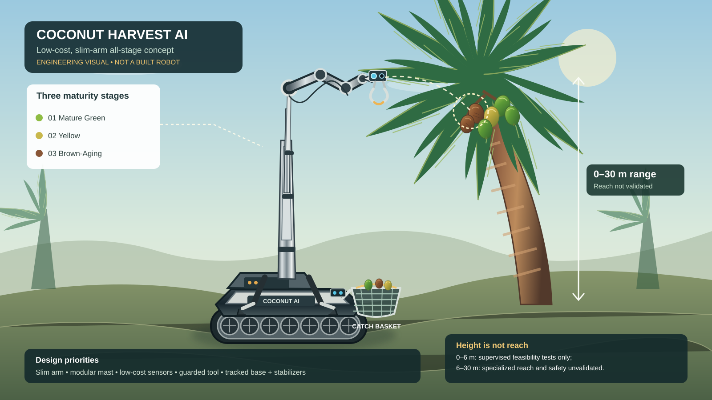
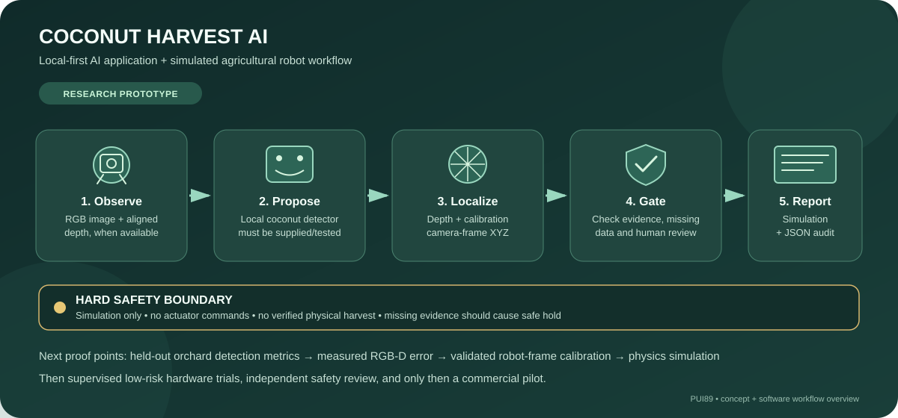

# Coconut Harvest AI


## Public privacy boundary

This public README is limited to the project overview, approved concept material and evidence that can be shared openly. Do not publish API keys, passwords, private tokens, Wi-Fi or internal network settings, private camera footage, personal or precise location data, detailed security configurations, unreleased engineering specifications, or confidential commercial plans. Keep sensitive material in an appropriately access-controlled private location. If a credential may have been exposed, revoke it; removing it from the latest commit does not remove it from Git history.

<!-- PUI89_PINNED_CONCEPT_ILLUSTRATION:START -->


*Conceptual design illustration — not a photograph of a built robot and not evidence of a successful harvest. The maturity classes and 0–30 m range are design goals; detection, reach, stability, cutting and safe operation remain unvalidated.*
<!-- PUI89_PINNED_CONCEPT_ILLUSTRATION:END -->

## Open-source-first engineering

PUI89 prioritises open-source software, transparent licensing, reproducible workflows and evidence-led collaboration. Model weights, datasets, hosted services and hardware are assessed separately for provenance, licence terms, security, data handling, resource requirements and intended use. Public availability alone does not establish permission for reuse or commercial deployment.


> **PUI89 engineering standard:** [Simple, Safe and Professional](https://github.com/Pui89/Pui89.github.io/blob/main/docs/PUI89_SIMPLE_SAFE_PROFESSIONAL_STANDARD.md) — shared guidance for usability, safety, evidence, privacy and maintainable engineering.


> **PUI89 | Intelligent Systems. Verifiable Decisions. Safer Outcomes.**
> 
> **Project:** Coconut Harvest AI  
> **Focus:** Agricultural AI application and proposed robotic harvesting system  
> **Development stage:** Software and evaluation-preparation prototype; physical harvesting capability is not validated.
> 
> **Project website:** [English](https://pui89.github.io/coconut.html) · [ภาษาไทย](https://pui89.github.io/coconut-th.html) · [PUI89 portfolio](https://pui89.github.io/)
> 
> **Validation boundary:** A trained detector with held-out real-image accuracy and a working physical harvesting robot are not established.

## Development stage

**Current stage:** Software & evaluation-preparation prototype  
**ขั้นการพัฒนา:** ต้นแบบซอฟต์แวร์และการเตรียมประเมินผล

**Evidence:** Software tests, benchmark preparation and dataset-audit notes are documented. No training dataset is approved and no field detector is validated.

**Limitations:** Real-image accuracy, a trained field detector, harvesting hardware and worker/animal safety are not validated.

**Next milestone:** Complete dataset-rights review, then run a reproducible held-out detector benchmark.


## Project website QR codes

<table><tr><td align="center"><strong>English website</strong><br><a href="https://pui89.github.io/coconut.html"></a><br><a href="https://pui89.github.io/coconut.html">Open English website</a></td><td align="center"><strong>เว็บไซต์ภาษาไทย</strong><br><a href="https://pui89.github.io/coconut-th.html"></a><br><a href="https://pui89.github.io/coconut-th.html">เปิดเว็บไซต์ภาษาไทย</a></td></tr></table>

## PUI89 development maturity snapshot — 12 November 2026

**Strategic direction: From AI Projects to AI Products.**  
**Current maturity: Level 4 — Tested Prototype.** This project has tested software and evaluation-preparation foundations; detector accuracy and physical harvesting remain unvalidated.


**Shared platform evidence (separate from project validation):** the PUI89 Shared AI Core main-branch CI reported 187 dependency-free tests passed on 11 November 2026. This platform-level result does not establish this project's model accuracy, physical integration or field performance.

| Area | Verified position |
|---|---|
| Software foundation | Shared-core checks, dataset preflight and evaluation tools are present; the 1 November evidence-benchmark workflow reported 6 standard-library tests passing. |
| Synthetic evaluation | Earlier recorded rule-based evaluation completed 7/7 scenarios and 9/9 steps; this is scenario/software evidence only. |
| Dataset and model | Real-image rights, provenance, annotation quality and held-out detector performance are not yet fully established. No validated detector accuracy is claimed. |
| Physical product | Four maturity categories, selective harvesting, arm/cutter/basket and 0–30 m reach remain design/research targets. No working harvesting robot or field-harvest capability is demonstrated. |

**Next product gate:** complete image-by-image source/licence and attribution review, real-file hash and annotation QA, leakage-safe dataset splits, then evaluate a defined detector on an independently held-out labelled set. Publish per-class precision/recall/F1, sample counts, thresholds, failure cases and runtime before advancing to hardware feasibility.

**Product discipline:** keep the training gate closed until data evidence is complete; distinguish software tests, model measurements, simulation and physical validation. No paid API, cloud GPU, automatic model download or physical robot actuation is part of this update.


## Project website

- **English:** https://pui89.github.io/coconut.html
- **ภาษาไทย:** https://pui89.github.io/coconut-th.html
- **PUI89 main website:** https://pui89.github.io/


## One-command local verification

Run `python tools/pui89_master_verify.py` for a standard-library-only Python syntax scan and inventory of this project's key verification tools. Add `--report verification-report.json` to save a JSON report. Use `--pytest` only when you want to run the full installed test suite; it installs nothing. The helper does not download models, call hosted APIs, change datasets, or control hardware. Tool presence is not proof that a gate passed, and software checks do not establish real-world performance.


## Latest engineering update — 1 November 2026

The new PUI89 Evidence Benchmark Engine is now exercised in hosted CI for this project. Its **6 standard-library tests passed**, and the simulation workflow completed successfully while generating a machine-readable evidence-integrity summary. [Open the benchmark-enabled simulation run](https://github.com/Pui89/Coconut-Harvest-AI/actions/runs/41222933984).

The benchmark checks report structure and metric consistency, hashes the source report and ordered world-state snapshots, and rejects any step that claims hardware actuation. It does not measure real AI accuracy, compare unlike projects, or validate physical performance. [Review the proposed implementation](https://github.com/Pui89/Coconut-Harvest-AI/pulls/160).

## Latest engineering update — 30 October 2026

The dataset evidence audit is now merged and has a successful hosted run: **15 standard-library tests passed** across dataset structure (5), image-hash integrity (5), and split-leakage checks (5). [Open the audit run](https://github.com/Pui89/Coconut-Harvest-AI/actions/runs/40944312469) · [Download/view its workflow artifact](https://github.com/Pui89/Coconut-Harvest-AI/actions/runs/40944312469).

The merged rule-based simulation evaluation also completed **7/7 scenarios and 9/9 steps, with 0 reported failures**. [Open the simulation run](https://github.com/Pui89/Coconut-Harvest-AI/actions/runs/40881372992).

These results verify the audit tooling and defined software scenarios only. They do not validate image reuse rights, human annotation correctness, detector accuracy, 0–30 m reach, or physical harvesting. The dataset training gate remains closed until provenance, licence, annotation and independent review requirements are satisfied.

## Current project status — 30 October 2026

**Overall status: software prototype and evaluation-preparation stage.** The combined PUI89 workflow has verified 13 shared-core tests, 5 detection-evaluator tests and 4 dataset-preflight tests for this project. These tests do not establish detector accuracy.

| Workstream | Current evidence | Status |
|---|---|---|
| Shared software core | 13 tests passed in the combined run | **Unit-tested** |
| Observation provenance guard | Regression coverage for missing, blank, whitespace-only and non-string source values; associated PR checks passed before merge on 30 October | **Software regression checks passed** |
| Detection metric evaluator | 5 tests passed; evaluates supplied predictions against labelled boxes | **Evaluator tested; AI accuracy not measured** |
| Dataset preflight tool | 4 tests passed on temporary synthetic fixtures | **Tool unit-tested; real dataset not yet validated by this run** |
| Real detector benchmark | No confirmed held-out ground-truth/prediction pair in the published run | **NOT RUN / NOT MEASURED** |
| Four maturity classes and 0–30 m reach | Design targets; no validated full-range detector or physical harvesting robot demonstrated | **Concept / research target** |
| Arm, cutter, basket and harvest verification | Design and software planning only | **Physical capability not validated** |

**Next gate:** complete source/licence review, manifest and annotation QA on the real dataset, prevent source/tree/session leakage, then run an actual detector on a held-out set and publish precision/recall/F1 with thresholds, counts and failure cases. Do not claim mAP from the single-threshold evaluator.

## Shared PUI89 AI Core — verification update (28 October 2026)

This project now shares a common set of software-contract and simulation-evidence checks with the other PUI89 AI applications. The latest test additions check that benchmark validation rejects inconsistent CSV row counts, a success status that conflicts with reported failures, and missing CSV evidence.

On 30 October, the shared observation-provenance guard was tightened to reject non-string, empty and whitespace-only source identifiers by routing them to human review. The focused regression checks passed in the pull-request workflows, and the fix is now merged into this repository's `main` branch. This validates input-handling behavior only; it does not verify sensor provenance in the real world or authorize hardware action.

- **Scope:** software tests and simulation-report integrity; not physical robot validation.
- **Safety boundary:** action proposals remain simulation-only; human review is retained where relevant.
- **Metrics:** publish performance figures only from reproducible runs with recorded scenarios, configuration, sample counts and measurement conditions.
- **Cross-project report:** [PUI89 Cross-Project Verification Snapshot](https://github.com/Pui89/Pui89.github.io/blob/main/PUI89_CROSS_PROJECT_VERIFICATION.md).
- **Latest automated checks:** [GitHub Actions](https://github.com/Pui89/Coconut-Harvest-AI/actions).

## local-first build policy and next upgrade

**Default rule: use existing local tools first; do not add recurring service dependencies.** The current workflow prioritises local execution and explicit review of external services.

- **Gate 1 — existing checks:** run `python tools/pui89_master_verify.py`; use the existing standard-library tests and CI before installing anything. A tool inventory is not a test pass.
- **Gate 2 — data before models:** keep all coconut candidates blocked until source/reuse terms, attribution, actual-file SHA-256, annotation geometry and independent review are recorded. Never train on draft labels.
- **Gate 3 — small reproducible baseline:** use a tiny, licensed, reviewed subset and CPU-compatible baseline first; report the exact split, sample counts, per-class metrics and runtime. Do not download large weights or claim 0–30 m performance without measured height labels and separate robot feasibility evidence.
- **Gate 4 — approve resource and licence requirements:** before any optional package, model or simulator install, check licence, download size, disk/RAM/VRAM fit and whether it can run offline. Ask before any external service or recurring commitment.
- **Release evidence:** save command, commit, environment, test result, dataset hash, failures and limitations. Keep physical harvesting status **not validated** until independently supported by hardware evidence.

## Engineering standards, architecture and project evidence

The [current software architecture](docs/ARCHITECTURE.md) separates implemented software checks from proposed perception and robot hardware. The [project overview diagram](docs/images/coconut-harvest-ai-overview.svg) is a concept/workflow illustration, not evidence of a completed machine.

**Standards used as design references (not compliance claims):**
- [ISO 12100](https://www.iso.org/standard/51528.html) — machinery risk assessment and risk reduction.
- [ISO 10218-1:2025](https://www.iso.org/standard/73933.html) and [ISO 10218-2:2025](https://www.iso.org/standard/73934.html) — industrial robot and application safety; applicability to a future agricultural/mobile system requires qualified review.
- [NIST AI Risk Management Framework](https://www.nist.gov/itl/ai-risk-management-framework) — AI risk lifecycle guidance.

The applicable standards and legal requirements must be confirmed for the final design, intended use and jurisdiction. Referencing a standard is not certification. The robot, arm, cutter, basket, lowering mechanism, calibrated perception and 0–30 m harvesting capability are **not physically validated**. See the [Product Quality and Safety Roadmap](docs/PRODUCT_QUALITY_AND_SAFETY_ROADMAP.md) and [System Fault and Hardware Safety Playbook](docs/SYSTEM_FAULT_AND_HARDWARE_SAFETY.md).

## Product quality and safety roadmap

The [Product Quality and Safety Roadmap](docs/PRODUCT_QUALITY_AND_SAFETY_ROADMAP.md) sets staged safety, reliability, evidence, human-oversight and buyer-readiness gates. It is an engineering plan—not certification or proof of field performance.

**Shared PUI89 AI Core contract:** [project adapter, data-provenance gates, annotation QA, leakage-safe splits and uncertainty-aware safe hold](docs/SHARED_PUI89_AI_CORE_INTEGRATION.md).

**Next action:** reconcile local image files and real hashes for candidates 0031–0034; then finish rights review and independent annotation QA. The training gate remains closed until the evidence is complete.


**AI-assisted selective coconut harvesting — four fruit/harvest categories, with a 0–30 m tall-palm reach as a long-term design target.**

> **Important status boundary:** The four maturity classes and 0–30 m range describe the intended system design, not validated capabilities. The repository currently contains software, dataset-review and synthetic-evaluation foundations; it does not demonstrate a trained, reliable all-stage coconut detector or a physical robot harvesting at any height. No field-harvest success is claimed.

## Real coconut-palm photograph


*Photograph: “Coconut in Coconut Tree” by Sarmi~Kili, taken in Sri Lanka. Source: [Wikimedia Commons](https://commons.wikimedia.org/wiki/File:Coconut_in_Coconut_Tree.jpg). Licensed under [CC BY-SA 4.0](https://creativecommons.org/licenses/by-sa/4.0/). This is a real orchard photograph, not a robot prototype or proof of detection performance. Image attribution and licence are provided for reuse; annotation boxes and training eligibility remain subject to separate review.*

## Four target categories

The intended workflow lets an operator choose a harvest target and asks the system to detect, classify, assess, and recommend action for each visible fruit or bunch:

1. **Young green coconuts** — identify fruit intended for young-coconut products, subject to defined maturity and market requirements.
2. **Mature green coconuts** — identify fruit assessed as mature for the intended use; green colour alone must not determine maturity.
3. **Yellow coconuts** — record the visible yellow category as a separate project-facing visual class; appearance alone cannot establish internal quality or intended use.
4. **Brown / aging coconuts** — identify brown or aging-looking fruit; exterior appearance alone cannot confirm internal dryness or quality.

A **mixed-stage bunch is a scene condition, not a maturity class**. Classify visible fruits individually where possible; do not assume every fruit in a bunch is at the same stage.

**Taxonomy alignment note:** These four names are the canonical project-facing visual categories used by the illustration, website, inspection tools and shared adapters. Older saved records may still contain the historical `developing_green` or `developing` label; those values are preserved as legacy history and are not silently converted to `yellow`. The illustration is not model output.

**Uncertain, hidden, damaged, occluded, or unsafe targets are not a fifth harvest category.** They are rejection / review conditions: mark them unknown, request human review, or stop. Never cut when target identity, reach, stability, clearance, tool readiness, or the required approval is uncertain.

## Intended harvesting workflow

Orchard image and sensor inputs → fruit / bunch detection → four-category classification with uncertainty → operator target selection → reach, stability, collision, and tool-readiness checks → human approval → controlled harvest only if all gates pass → fruit capture / lowering → result verification and event log.

This workflow describes the intended system. Components currently implemented in software are identified separately below; the complete physical workflow has not been validated.


## Four-class annotation policy

Use the [Four-Class Coconut Annotation Policy](docs/FOUR_CLASS_ANNOTATION_POLICY.md) to label visible fruit consistently, separate maturity classes from occlusion/uncertainty, review AI-proposed boxes, and keep unverified examples out of training. It is a proposed human-review standard, not a claim that the current dataset is approved.

## Four-class and 0–30 m validation plan

The staged validation gates, class definitions, dataset requirements, reproducible metrics, safe-stop tests, and physical reach evidence needed to progress responsibly are documented in the [Four-Class Coconut Harvesting and 0–30 m Validation Roadmap](docs/FOUR_CLASS_0_30M_VALIDATION_ROADMAP.md). This is a plan, not evidence that these capabilities are already validated.

## local-first offline engineering tools

- **Robotics stack selection:** [selected systems, licence notes and adoption gates](docs/FREE_ROBOTICS_STACK_ADOPTION.md). These are recommendations only; no robotics packages or model weights are installed or downloaded by this PR.
- **local agentic AI:** [optional agents, local runtimes, licence notes and safety gates](docs/LOCAL_AGENTIC_AI.md); discover what's already installed with `python tools/check_optional_resources.py`. No models or packages are downloaded automatically.
- **Model-optional agentic workflow:** `agents/agentic_workflow.py` sequences input validation, the existing decision agent, a policy gate and an evidence-hash report; it requires human review and never runs actions.
- **Run the local agentic workflow:** `python -m tools.run_agentic_workflow --input examples/agentic_workflow.synthetic.json` — standard-library only; synthetic inputs, review output, no model download or actuator control.
- **Synthetic agent evaluation:** `python -m tools.evaluate_agentic_workflow` runs the labelled synthetic suite; the protocol documents measured decision-workflow latency and limitations. No model, network, third-party package or hardware action is used.
- **Phased autonomy lab:** [test and simulation guide](docs/PUI89_AUTONOMY_LAB.md); runner: `tools/pui89_autonomy_lab.py`; project scenarios: `simulation/scenarios.json`. Includes logged world-state snapshots, safe-hold/UNKNOWN mock VLA gates, reproducible JSON/CSV reports and an offline model-resource preflight. No model is downloaded or installed automatically; no hardware is controlled.

- offline dataset/annotation checks (provenance, normalized boxes, duplicate hashes): `scripts/free_first_project_tools.py`; tests: `tests/test_free_first_project_tools.py`. For candidate 0032, `tools/record_coconut_source_hash.py` can verify a local file against the source page's published SHA-1 and byte size, then record SHA-256 only with explicit `--write-source-sha256`; tests: `tests/test_record_coconut_source_hash.py`. `tools/audit_coconut_annotation_provenance.py` independently checks the recorded hash and rights metadata. Neither tool approves human QA or training.
- standard-library-only precision, recall, F1 and confusion-count metrics for later reproducible model evaluation; no accuracy claims are made until measured on a leakage-safe held-out set.

- Shared world-state tracker: `pui89_autonomy/world_state.py` tracks time-stamped observations, hazards, stale data, low confidence and conflicting labels; uncertain tracks remain unknown.
- Reproducible experiment report builder: `pui89_autonomy/experiment_report.py` summarizes supplied metrics, dataset SHA-256, code version and latency samples without inventing missing measurements.
- Tests: `tests/test_world_state.py` and `tests/test_experiment_report.py`; CI runs these standard-library tests. These tools are software scaffolds, not proof of physical performance or safety.

- **Full robotics stack integration:** [ROS 2 Jazzy, Gazebo Harmonic, Nav2, optional autopilot choice, and offline SmolVLM test](docs/PUI89_FULL_ROBOTICS_STACK_INTEGRATION.md). Starter worlds and source scaffolding are provided; the robotics stack is not installed or hardware-validated.

## Frontier AI technology and local-first upgrade plan

Current gaps, recent technology directions, open-source-first adoption gates, and project-specific next steps: [Frontier technology gap and local-first plan](docs/FRONTIER_TECHNOLOGY_GAP_AND_FREE_PLAN.md). No large model or simulator is installed automatically; verify licences, download size, hardware fit and resource requirements first. Project-specific implementation priorities: [Frontier AI upgrade plan](docs/FRONTIER_AI_UPGRADE_PLAN.md).


## Current verified status — 26 October 2026

**Stage:** local software, data-quality and evaluation foundations. The four target maturity classes and 0–30 m reach are design goals only; this repository does not yet demonstrate a validated physical coconut-harvesting robot.

- **Synthetic evaluation — 26 October 2026:** the labelled synthetic suite reports 7/7 scenarios passed, and adversarial workflow regression tests are merged. This validates these synthetic software paths only; it does not establish coconut-detection accuracy, harvest success, or physical robot capability.

**Protection policy:** [Automated protection and fail-safe policy](docs/AUTOMATED_PROTECTION_POLICY.md). This documents required software safeguards and validation gates; it does not claim physical safety or validated operational performance.

- **SAM 3 segmentation:** the optional local smoke-test script and guide are merged ([PR #80](https://github.com/Pui89/Coconut-Harvest-AI/pull/80)). No SAM 3 inference result has been verified yet. Model weights are downloaded only when the script is run; check compatibility, access terms, disk space and GPU memory first.
- **Automated checks for the SAM 3 change:** the Python tests, main CI, security checks and Ruff helper review completed successfully for the change's pull-request commit. These checks do not measure segmentation accuracy.
- **Dataset gate:** the existing project snapshot reports 34 candidate records and 0 approved for training. Resolve label/geometry and source-permission reviews before training or publishing model metrics.
- **Fault-monitor contract:** documentation-only contract merged in [PR #79](https://github.com/Pui89/Coconut-Harvest-AI/pull/79). The Python fault-monitor component has unit tests, but the contract does not itself connect to physical actuators or provide hardware safety.
- **Next:** run the smoke test on one approved local image; review its mask manually; then complete the dataset gate and run a held-out detector benchmark with precision, recall, F1 and latency.
- **Evidence boundary:** CI success is software evidence only. Coconut detection, maturity classification, 3D targeting, harvest reach, cutting, capture and real-orchard operation remain unvalidated unless separately measured.


nceptual design illustration — not a photograph of a built robot and not evidence of a successful harvest. The four target maturity classes and 0–30 m range are intended design goals; detection accuracy, maturity classification, reach, stability, cutting, fruit retention, safe lowering, and real-orchard operation remain unvalidated.*

## Optional local Hugging Face vision experiment

Try open-vocabulary coconut detection on a local image with [`tools/huggingface_local_vision_demo.py`](tools/huggingface_local_vision_demo.py). Read [`docs/HUGGINGFACE_LOCAL_VISION.md`](docs/HUGGINGFACE_LOCAL_VISION.md) first. This is an exploratory pretrained-model demo, not a trained or validated coconut detector; the dataset approval gate remains unchanged.

## Local fault-monitoring software (initial implementation)

A small, dependency-light Python module accepts explicit fault reports, suggests conservative responses, and keeps a bounded in-memory event log. It includes automated unit tests and a GitHub Actions test workflow. It is not an antivirus, intrusion detector, gunshot detector, or physical safety controller; hardware shutdown, persistent audit storage, alerts, and real-world threat detection require separate implementations and validation.

- [Fault monitor integration guide](docs/FAULT_MONITOR_INTEGRATION.md)
- [Fault monitor source](apps/pui89_safety/fault_monitor.py)
- [Fault monitor tests](tests/test_fault_monitor.py)


## Project status — 22 October 2026

**Current stage:** software and data-quality foundations; not yet a validated real-world harvesting robot.

- **Verified CI:** the latest commit's agent unit tests, Coconut AI regression tests, Python tests, main CI workflow, and GitHub Pages build/deployment all completed successfully. [Latest agent-test run](https://github.com/Pui89/Coconut-Harvest-AI/actions/runs/39733576754) · [Latest main CI run](https://github.com/Pui89/Coconut-Harvest-AI/actions/runs/39733576516).
- **Dataset gate:** 34 candidate records are in the current review snapshot; 0 are approved for training. Candidate source permissions, annotation correctness, and independent QA must be checked before training or performance claims.
- **Implemented:** local annotation/evaluation utilities, source-provenance workflow, structural dataset audit, rule-based safety decision support, and regression tests.
- **Next milestone:** run the candidate-fetch and dataset-audit commands, manually review suitable images, create human-checked annotations and a held-out test split, then publish actual detector metrics. The existing tiny baseline is not evidence of a trained coconut detector.
- **Limits:** CI success verifies software checks only; it does not demonstrate detector accuracy, GPU performance, robot-arm operation, or field harvesting.


## Fail-safe operating modes (software prototype)

The project defines three modes: **AI operation**, **limited safe operation**, and **manual recovery**. Fault responses are designed to fail conservatively:

| Problem | Expected robot response |
|---|---|
| AI model crashes | Stop harvesting and keep the cutter disabled; independent safety monitoring must remain active. |
| Camera or safety sensor fails | Stop autonomous movement if safe navigation cannot be confirmed; request operator recovery. |
| Wi-Fi or remote connection is lost | Stop the mission and enter a safe hold; do not continue hazardous work without required supervision. |
| Battery becomes low | Stop harvesting; return only if the route is verified, navigation is healthy, and sufficient reserve remains. Otherwise request recovery. |
| Main computer freezes | An independent watchdog and hardware safety circuit must disable hazardous actuators; software alone cannot guarantee this. |
| Robot gets stuck or tips | Disable cutting, stop or brake movement as appropriate to the physical hazard, alert the operator, and follow a planned recovery procedure. |

- [Fail-safe mode design and fault responses](docs/FAIL_SAFE_OPERATING_MODES.md)
- [System fault, hardware, electrical, and recovery playbook](docs/SYSTEM_FAULT_AND_HARDWARE_SAFETY.md)
- [Fail-safe decision selector](src/coconut_harvest_robot/failsafe.py)
- [Fail-safe tests](tests/test_failsafe.py)

**Status and limitation:** this is a software decision prototype, not a validated physical robot safety system. Real hardware requires independent emergency-stop circuitry, motor/arm interlocks, safe braking/holding behaviour, and staged physical validation.

## Decision-support agent (current scope)

**This rule-based agent uses the repository's Python code and supplied inputs.** It does not call a hosted AI API or cloud service, or download model weights. Local Python/test tooling and GitHub usage remain subject to their own terms and limits.

**What it does:** Checks supplied target confidence, sensor health, depth, reachability, obstacle clearance, and human approval. It does not run a detector or command a robot arm.

```text
Orchard image / sensor measurements → rule-based safety checks → harvest recommendation or STOP → human approval
```

- **Run guide:** [Agent guide](docs/AGENT_GUIDE.md)
- **Important limitation:** this is a rule-based decision-support prototype, not proof of real-world performance. Hardware, optional third-party services, or future model training may have separate funding requirements.


> **Product quality standard:** [benchmark protocol and fair comparison criteria](docs/PRODUCT_BENCHMARK_STANDARD.md). This defines what we need to measure; it does not claim market-leading performance.

> **Next research milestone — real detector evidence:** review image rights, annotate a small set of distinct orchard images, freeze a held-out test split, run an existing compatible local coconut detector, and publish its actual predictions plus precision/recall/F1 and latency. The current two-image baseline remains at precision 0 and recall 0 at IoU ≥ 0.50 until a new run is completed. [Follow the operator checklist](docs/FIRST_REAL_IMAGE_BENCHMARK_CHECKLIST.md). Do not treat example CSV rows, reference photographs, or latency-only results as accuracy evidence.


## Run the project unit tests

Run the focused, lightweight unit tests locally with Python 3.10 or newer:

```bash
python -m pip install pytest
python -m py_compile agents/project_agent.py tests/test_project_agent.py tools/evaluate_coconut_detections.py tests/test_evaluate_coconut_detections.py tools/annotations_to_ground_truth_csv.py tests/test_annotations_to_ground_truth_csv.py
python -m pytest -q tests/test_project_agent.py tests/test_evaluate_coconut_detections.py tests/test_annotations_to_ground_truth_csv.py
```

A dedicated [GitHub Actions workflow](https://github.com/Pui89/Coconut-Harvest-AI/actions/workflows/agent-tests.yml) is configured to run the decision-agent, detector-evaluator, and annotation-converter tests on Python 3.10, 3.11, and 3.12 when relevant files change. Check the Actions page for the actual run status; adding this workflow does not itself mean the tests have passed.

## Start here — reviewer quick guide

- **Research case study:** [read the concise problem, current implementation, evidence limits, and proposed evaluation plan](docs/RESEARCH_CASE_STUDY.md).
- **selected model strategy:** [review license-first model selection and the reproducible coconut benchmark plan](docs/LICENSE_FIRST_MODEL_STRATEGY.md), including the hosted RT-DETR smoke test and license caveats.
- **Dataset readiness:** [see the current review-gate snapshot](docs/COCONUT_DATASET_READINESS.md): 34 candidate records reviewed, none approved for training yet, with an explicit annotation next step.
- **One-command local preflight:** [read-only dataset preflight tool](tools/run_coconut_dataset_preflight.py) combines geometry checks and the rights/review promotion gate; source-byte checking is optional and never auto-approves training.
- **Windows shortcut:** run `.\scripts\run_coconut_preflight.ps1` from the repository root to generate `reports/coconut-preflight-report.json`; optional `-Image0032 "C:\path\to\0032_Coconut_in_Coconut_Tree.jpg"` adds the read-only source-byte check. No packages/models are installed or downloaded, and no approval fields are changed.
- **One-click Windows CMD shortcut:** double-click `RUN_COCONUT_PREFLIGHT.bat` from the repository root. It checks for required files, runs the same read-only geometry/ledger preflight, and saves `reports/coconut-dataset-preflight-report.json`. If this copy is missing newer helper files or ledgers, it stops with a clear message. No package installation, model download, upload, annotation edit, or automatic training approval occurs. `BLOCKED` or `INCOMPLETE` is an honest expected outcome until outstanding human/source checks are complete.
- **New image-source shortlist (review only):** [five Wikimedia coconut-image candidates with source-page, attribution, licence, and annotation-review requirements](docs/COCONUT_IMAGE_SOURCE_SHORTLIST_2026-10-22.md). None is automatically approved for training.

- **What works now:** [run the local planning prototype](#run-the-local-prototype), inspect the synthetic workflow, and review the annotation/evaluation tools.
- **What the evidence says:** [read the measured baseline](#current-evaluation-evidence), including the two-image HSV smoke test, where precision and recall were both 0 at IoU ≥ 0.50.
- **What comes next:** [follow the real-image benchmark checklist](docs/FIRST_REAL_IMAGE_BENCHMARK_CHECKLIST.md) to establish image rights, review labels, run an existing compatible detector, and record reproducible results.
- **What is not yet proven:** a reliable trained coconut detector, generalisation across orchards, maturity classification, calibrated 3D targeting, or a physical robot harvesting coconuts.

**For a fair assessment:** automated tests demonstrate software behaviour; concept images explain the intended design; only reproducible held-out experiments establish model performance. This repository keeps those evidence types separate.


### Work locally on Windows

- **Annotate real coconut images (Windows):** [step-by-step offline annotation quick start](docs/WINDOWS_COCONUT_ANNOTATION_QUICKSTART.md). This avoids the common error of launching `tools\\coconut_annotator.html` from the wrong folder.

- **Run the demo app:** double-click [`RUN_COCONUT_APP.bat`](RUN_COCONUT_APP.bat). It requires Python and the app dependencies to be installed first.
- **Run a local detector latency benchmark:** double-click [`RUN_COCONUT_DETECTOR_BENCHMARK.bat`](RUN_COCONUT_DETECTOR_BENCHMARK.bat), then enter paths to an existing compatible coconut-trained `.pt` model and a permitted local test image. It checks imports but installs/downloads nothing. It measures latency only—not detection accuracy—and cannot run until you already have suitable model weights.
- **Label orchard images offline:** double-click [`OPEN_COCONUT_ANNOTATOR.bat`](OPEN_COCONUT_ANNOTATOR.bat). Select image files from your computer, draw boxes around visible coconuts, and export the annotation JSON. Images are processed in your browser and are not uploaded by this tool.
- **Important:** annotation quality and image reuse rights still need human review. Do not use the archived first-pass labels as training data; see [the review batch notes](data/review_batch_2026-10-18/README.md).

- **Commercial path:** [commercialisation roadmap](docs/COMMERCIALISATION_ROADMAP.md) — proposed first customer problem, software-first MVP, discovery questions, evidence gates, and a staged path toward robotics.
- **Customer discovery:** [orchard interview guide](docs/ORCHARD_CUSTOMER_DISCOVERY.md) — a 15-minute, interview script and evidence/consent rules to test whether the problem is real before building more.

## Strategic partnerships, funding and collaboration

### Help advance practical agricultural AI

Coconut Harvest AI is an evidence-first software and robotics concept for coconut inspection and harvesting workflows. We are interested in conversations with organisations that can help validate the problem, strengthen the evidence, and define a responsible development pathway.

**Who we would like to hear from**
- **Plantations, growers and agricultural organisations** — workflow discovery, operator requirements, orchard access under agreed conditions, and feedback on harvesting priorities.
- **Agricultural equipment and robotics companies** — engineering review, mechanical design advice, integration options, and potential in-kind support.
- **Universities and research teams** — computer vision, agricultural robotics, annotation quality, benchmark design, safety and independent evaluation.
- **Grant makers and innovation programmes** — support for clearly scoped milestones such as rights-cleared data preparation, reviewed annotations, benchmark development, or simulation and prototype engineering.

**Potential first collaboration**
Define one orchard workflow and measurable acceptance criteria; confirm permissions and data provenance; build a reviewed benchmark; then evaluate software and simulation results before proposing any physical trial. A pilot or field trial would require separate written agreement, risk assessment, appropriate equipment and authorisation.

**Current boundary:** this repository contains software, evaluation tools and a proposed robot design. It is not a commercially released harvesting product. Detector accuracy, 0–30 m operation, physical harvesting, worker/animal safety and field performance are not established by the software tests or simulation evidence described above.

**Start a conversation**
- [Strategic partnership and funding enquiries](https://pui89.github.io/support.html#partner-pathways)
- [ภาษาไทย: ความร่วมมือเชิงกลยุทธ์](https://pui89.github.io/support-th.html#partner-pathways)
- [PUI89 project website](https://pui89.github.io/)
- [PUI89 support and sponsorship brief](https://github.com/Pui89/Pui89.github.io/blob/main/SUPPORT_AND_SPONSORSHIP.md)

Please describe the agricultural problem, the relevant operating context, the contribution or support available, and the milestone you would like to explore. No funding, customer relationship, deployment or performance outcome is implied by an enquiry. Any data access, funding and resource requirements, intellectual property, responsibilities and pilot scope must be agreed in writing before work begins.
## Latest engineering update — 21 October 2026

- **Benchmark tooling:** the adaptive CPU microbenchmark with no additional package dependencies is available at [`tools/adaptive_compute_benchmark.py`](tools/adaptive_compute_benchmark.py), with regression tests in [`tests/test_adaptive_compute_benchmark.py`](tests/test_adaptive_compute_benchmark.py). It compares synthetic integer-reduction implementations; it is **not** an AI inference, energy-use, or robot-performance benchmark.
- **Input validation:** malformed benchmark argument types are now rejected clearly. The change was merged in [PR #36](https://github.com/Pui89/Coconut-Harvest-AI/pull/36).
- **Verification:** GitHub Actions passed the repository test suite on Python 3.10, 3.11, and 3.12 for the PR head before merge.
- **Evidence boundary:** this update does not change the initial real-image baseline reported below (precision 0 and recall 0 at IoU ≥ 0.50 on two images). Real-orchard generalization and physical harvesting remain unvalidated.
- **Fair model comparison:** added [`tools/compare_coconut_detectors.py`](tools/compare_coconut_detectors.py), regression tests, and a [comparison protocol](docs/FAIR_DETECTOR_COMPARISON.md). It ranks supplied prediction exports against the same reviewed ground truth and thresholds; it does not run models or claim better AI performance.
- **Reproducible detector evaluation:** added [`tools/evaluate_coconut_detections.py`](tools/evaluate_coconut_detections.py), unit tests, and a [CSV protocol](docs/REPRODUCIBLE_DETECTION_EVALUATION.md) for evaluating externally produced detector boxes. This tool does not run a model, and no new AI performance result is claimed.
- **Dataset split-leakage audit:** added [`tools/audit_dataset_split_leakage.py`](tools/audit_dataset_split_leakage.py), tests, and a [manifest guide](docs/DATASET_SPLIT_LEAKAGE_AUDIT.md). It checks recorded SHA-256 values and source-group IDs across splits; it does not compute file hashes or claim improved detector performance.
- **First real-image benchmark checklist:** added [the end-to-end manual workflow](docs/FIRST_REAL_IMAGE_BENCHMARK_CHECKLIST.md), linking rights review, human annotations, geometry checks, split-leakage audit, and actual detector predictions. It explicitly stops short of claiming results until real inference is run.
- **Actual image-hash verification:** added [a local SHA-256 verifier](tools/verify_image_manifest_hashes.py), tests, and a [usage guide](docs/VERIFY_IMAGE_MANIFEST_HASHES.md). Unlike the manifest-only audit, it computes hashes from files on disk and flags exact-byte duplicates across splits; it does not detect resized or near-duplicate images.


**AI-assisted coconut detection, harvest-stage decision support, and agricultural robotics concept**

Coconut Harvest AI is a local-first software and robotics project exploring how computer vision, conservative planning, and human supervision could support coconut inspection and harvesting workflows.

The project aims to help an operator review individual coconuts, choose an intended harvest stage, assess candidate targets, and investigate safe robot integration. It is **not a finished or field-validated harvesting machine**.



### Real-world coconut imagery — illustrative references

<a href="https://commons.wikimedia.org/wiki/File:Fruiting_Coconut_Palm_Canopy.jpg"></a>

*Fruiting Coconut Palm Canopy — an orchard-context reference photograph. [Open the source and licence details on Wikimedia Commons](https://commons.wikimedia.org/wiki/File:Fruiting_Coconut_Palm_Canopy.jpg). This is not a PUI89 field capture, an annotated training image, an AI prediction, or evidence of detector performance.*

These source-linked photographs help explain the orchard setting and fruit visibility challenges. **They are illustrative references, not labelled training data or evidence of model performance.** Check each source page before reuse; the photos have not been added to the project's dataset.

| Reference | Intended use and rights |
|---|---|
| [Fruiting Coconut Palm Canopy](https://commons.wikimedia.org/wiki/File:Fruiting_Coconut_Palm_Canopy.jpg) — [view original image](https://commons.wikimedia.org/wiki/Special:FilePath/Fruiting_Coconut_Palm_Canopy.jpg) | CC0 1.0, according to the source page. Candidate for an orchard-context visual; inspect at full resolution before use. |
| [Coconut palm plantation, Koh Mak, Thailand](https://commons.wikimedia.org/wiki/File:Koh_Mak_(island),_Thailand,_Coconut_palm_plantation.jpg) — [view original image](https://commons.wikimedia.org/wiki/Special:FilePath/Koh_Mak_(island),_Thailand,_Coconut_palm_plantation.jpg) | Photo by Vyacheslav Argenberg; CC BY 4.0, according to the source page. Attribution is required; verify licence details and record any changes before redistribution. |

**Data-quality rule:** a visually attractive orchard photo is not automatically suitable for detection training. Dataset inclusion requires rights review, original-file checks, target visibility, annotation QA, duplicate/leakage checks, and a reproducible evaluation split.

## Project at a glance

| Topic | Current position |
|---|---|
| Project type | Agricultural AI and robotics R&D |
| Available software | Rule-based planning agent, synthetic workflow demo, and manual image-review tools |
| Physical robot | Proposed concept; complete robot harvesting is not demonstrated |
| Real-image AI performance | Initial two-image baseline scored 0 precision and 0 recall at IoU ≥ 0.50; more data and reviewed labels are needed |
| Development approach | Local-first, using selected tools where practical |
| Immediate focus | Rights-cleared data, annotation quality, reproducible evaluation, and simulation |

**Explore:** [Run the prototype](#run-the-local-prototype) · [Current evaluation evidence](#current-evaluation-evidence) · [Development roadmap](#development-roadmap) · [Safety and limitations](#safety-and-limitations)

**Engineering assurance:** [project requirements, hazard log, verification/validation gates, and evidence rules](docs/ENGINEERING_ASSURANCE_PLAN.md).

**Experiment records:** use the [reproducible experiment report template](docs/EXPERIMENT_REPORT_TEMPLATE.md) to record each dataset, model, threshold, metric, failure case, and rerun without overstating results.

**Dataset promotion gate:** [fail-closed rights + annotation approval checks](docs/COCONUT_DATASET_PROMOTION_GATE.md). This joins the current source-rights and candidate-review ledgers and intentionally blocks training until both record explicit, matching approvals.

**Research evaluation:** [reproducible research evidence checklist](docs/RESEARCH_EVIDENCE_CHECKLIST.md) for dataset controls, held-out metrics, run records, and the boundary between AI benchmarks and physical-robot claims.

**Immediate research next steps:** [focused evidence sprint](docs/RESEARCH_EVIDENCE_SPRINT.md) with the first real-image evaluation sequence, exact local commands, reproducibility requirements, and resource, licence and safety boundaries.

**Limited-compute option:** [lightweight laptop-friendly workflow](docs/LIGHTWEIGHT_LAPTOP_WORKFLOW.md) prioritising CPU tests and data-quality checks before any large model download.

**Hardware-specific plan:** [16 GB RAM / 4 GB GPU compute profile](docs/COMPUTE_PROFILE_16GB_4GB_GPU.md) for this laptop class, including preflight checks, low-memory experiment choices, and evidence boundaries.


## Two parts of the project

<details>
<summary><strong>1. AI application — software for inspection and decision support</strong></summary>

The software side is intended to help a user review candidate coconuts, record the requested harvest stage, inspect uncertainty and safety checks, and produce an auditable planning report.

**Available now:** a rule-based planning agent, synthetic workflow demonstrations, and tools for manual image review and annotation quality checks.

**Not yet established:** reliable automatic coconut detection and maturity classification across real orchards, calibrated 3D fruit localization, or a validated model that can decide independently which fruit is ready to harvest.

</details>

<details>
<summary><strong>2. Physical AI robot — proposed machinery for future field work</strong></summary>

The robot concept shows how cameras and optional depth sensors could be combined with a mobile platform, a suitable reach mechanism, guarded cutting hardware, fruit retention or lowering, and independent safety controls.

**Current status:** concept and engineering workflow only. The repository does not demonstrate a complete physical robot performing validated coconut harvesting. The 0–30 m palm-height range is a long-term feasibility challenge, not a tested operating range.

</details>

**How they connect:** the application may recommend a candidate and a plan; a future robot would still need independently validated localization, reachability, hardware interlocks, human approval, and verified fruit collection. A software recommendation must never directly authorize a physical cut.


> **Current capability boundary:** this repository contains software prototypes, synthetic-data demonstrations, planning workflows, tests, and engineering concepts. The four canonical project-facing visual categories are young green, mature green, yellow, and brown/aging. Human-led inspection tools and shared adapters use these labels for new records; historical `developing_green` / `developing` values remain unchanged and require human reassessment. Mixed-stage bunches are a scene condition, not a maturity class. Reliable classification, calibrated orchard-wide 3D localization, physical cutting and fruit collection, and operation at any height are not demonstrated capabilities. The 0–30 m range is a long-term design challenge, not a proven robot reach specification.

## What the project includes

- **Local software workflow:** prototype code for reviewable candidate decisions and audit reports.
- **Harvest-planning agent:** a deterministic, rule-based tool that evaluates supplied candidate information; it does not detect fruit directly from image pixels.
- **Synthetic end-to-end demo:** exercises software gates and report generation without sending commands to physical actuators.
- **Real-image review workflow:** prepares a local manual-review sample and annotation sheet; it is not automatic detection.
- **Annotation overlay review tool:** a local OpenCV script renders existing boxes over original images for human QA; it does not certify annotations or detect fruit.
- **Robot concept and architecture:** outlines possible perception, target review, planning, and future hardware integration.
- **Resource-conscious development:** prioritizes local tools and selected workflows.

## How the system is intended to work

```text
Camera / optional depth sensors
            |
            v
Input quality and sensor checks
            |
            v
Coconut detection and stage assessment
            |
            v
Operator selects harvest stage or survey-only mode
            |
            v
Candidate review: uncertainty, location, reach and obstacles
            |
            v
Human approval + independent safety checks
            |
            v
Future validated robot mechanism (not implemented here)
            |
            v
Outcome verification and audit record
```

Each visible coconut should be assessed separately, including fruit in mixed-stage bunches. The operator's selected stage filters candidates but never overrides uncertainty or safety checks. If evidence is missing, a target is unclear, reach is unverified, or a hazard is detected, the intended response is **SURVEY ONLY / NO CUT**.

## Coconut stages and per-fruit decisions

| Observation | Intended software response | Intended action policy |
|---|---|---|
| Young green | Propose a class only when supported by agreed, validated criteria | Consider only if the operator selected this class and safety checks pass |
| Mature green | Keep separate from young green; green colour alone does not prove maturity | Require validated maturity criteria and confirmation |
| Yellow | Record as a separate visual category; maturity and suitability still require validated criteria | Human review; no automatic cut |
| Brown / aging | Propose a provisional visible-appearance class with evidence and uncertainty | Consider only if selected and all safety checks pass |
| Mixed-stage bunch | Assess each fruit individually | Filter each candidate separately |
| Occluded, blurry, cropped, or ambiguous fruit | Mark uncertain or request another view | No automatic cut |
| Damaged or abnormal fruit | Flag for review | Exclude from normal automatic harvesting |
| Survey-only request | Detect or record candidates without selecting a harvest target | No cutting |

These are intended classes and policies, not a claim that a reliable model for every class is already trained. Local growers should define criteria appropriate to cultivar and intended use.

## How the system handles each coconut

The intended workflow treats **each visible fruit as a separate candidate**, even when several coconuts share one bunch. The operator's choice determines which maturity category is requested; it does not force the AI to label an uncertain fruit or permit an unsafe cut.

1. **Capture and inspect the view.** Check image sharpness, lighting, occlusion, and whether the fruit is sufficiently visible. Request another view or mark the candidate uncertain when the image is inadequate.
2. **Detect and separate candidates.** A future validated vision model should assign a distinct candidate ID and bounding region to each visible coconut. Overlapping fruit must not be assumed to be one fruit or confidently split without evidence.
3. **Estimate maturity with uncertainty.** Use validated visual and, where available, additional sensor evidence. Colour alone is not enough to reliably distinguish young green, mature green, yellow, and brown/aging coconuts or establish harvest readiness.
4. **Apply the operator's selection.** Keep candidates that match the requested stage; label non-matching candidates as “not selected.” Keep survey-only mode available when the operator wants inspection without harvesting.
5. **Check localization and reach.** Verify the candidate's 3D position, tool approach, obstacles, robot stability, and whether the actual mechanism is validated for that height. If any required measurement is missing or outside the verified operating envelope, return **NO CUT**.
6. **Require approval and safety interlocks.** Before any future physical cutting trial, require explicit human approval and independent hardware safety controls. The software prototype in this repository does not command a real cutter.
7. **Verify the outcome.** A future system should confirm whether the fruit was safely retained or lowered and record failures separately. A detection, plan, simulated action, or attempted cut must never be counted as a successful harvest by itself.

| Example situation | Candidate decision | Cutting policy |
|---|---|---|
| Requested mature-green fruit, clear image, validated maturity evidence | Eligible for further review | Only after all reach, safety, and approval gates pass |
| Young green fruit when brown/dry fruit was requested | Not selected | No cut |
| Brown-looking fruit with uncertain maturity | Uncertain; request another view or human review | No cut |
| Fruit partly hidden behind leaves or another coconut | Incomplete evidence | No cut |
| Fruit appears reachable but 3D position or tool clearance is unverified | Reachability unknown | No cut |
| Fruit is above the mechanism's verified reach envelope | Out of range | No cut |
| Operator chooses survey-only mode | Record/review candidate only | No cut |
| A cut is attempted but fruit collection is not confirmed | Outcome unverified | Do not report harvest success |

**Implementation status:** This section documents the intended system behaviour. It does not mean that all seven stages, an all-maturity detector, 3D localization, physical cutting, or harvest verification are already implemented. Current implementation details and evaluation evidence are listed in the status and benchmark sections below.

## Robot concept


A future system may combine a mobile platform, camera and optional depth sensors, a suitable high-reach mechanism, a guarded cutting tool, fruit retention or lowering, emergency stops, and independent safety controls. A compact ground robot with a short arm cannot reach a 20–30 m palm crown by itself. Any high-reach design requires separate mechanical feasibility and safety validation.

### Tree-height scope

| Approximate height | Intended development scope | Current status |
|---|---|---|
| 0–3 m | Supervised perception and guarded test-rig feasibility | Candidate first test range; physical harvesting is not validated |
| 3–6 m | Study an engineered mast or lift | Concept/feasibility work |
| 6–12 m | Study purpose-built high-reach or climbing mechanisms | Not demonstrated |
| 12–20 m | Study specialist access, retention, and exclusion-zone requirements | Unvalidated engineering challenge |
| 20–30 m | Assess specialist solutions and alternatives to a ground-mounted arm | Outside demonstrated capability |

Detection at a height does not mean the robot can reach or harvest at that height. If reach, localization, stability, collision clearance, weather conditions, fruit capture, or the exclusion zone cannot be verified, the system must not initiate a cut.

## Implemented software vs. planned capabilities

| Area | Status |
|---|---|
| Rule-based harvest-planning agent | Code is available; evaluates supplied candidate fields and creates an auditable proposal |
| Synthetic end-to-end workflow | Available for software testing; synthetic inputs are not field evidence |
| Manual real-image review | Workflow and guide are available; this is not automatic detection |
| Coconut-specific model generalization | Not established; requires a larger, rights-cleared, independently reviewed dataset and held-out evaluation |
| Reliable all-stage maturity classification | Not established |
| Calibrated 3D localization and real robot reachability | Requires sensor calibration and independent validation |
| Physical cutting, collection, and autonomous harvesting | Not demonstrated |
| Safe operation at 0–30 m | Not demonstrated; long-term feasibility challenge |

## Current evaluation evidence

The first candidate batch was visually triaged across 30 images. Only two close-up images had first-pass boxes, totalling 15 reference boxes; the annotations still require independent review.

A simple OpenCV HSV-contour baseline was evaluated on those two images:

| Measure | Initial result |
|---|---:|
| Images evaluated | 2 |
| Reference boxes | 15 |
| Predicted boxes | 20 |
| Precision at IoU ≥ 0.50 | 0.000 |
| Recall at IoU ≥ 0.50 | 0.000 |
| F1 at IoU ≥ 0.50 | 0.000 |
| Mean CPU runtime | 15.12 ms/image |

This is a weak, simple non-ML smoke-test baseline, **not** a trained detector benchmark. Two images are insufficient to support generalization claims. The result is included transparently so the next experiments have a clear baseline.

**Reproducible evidence:** [raw benchmark report (JSON)](data/review_batch_2026-10-18/benchmark_report_v0.1.json) · [candidate review and annotation status](data/review_batch_2026-10-18/README.md) · [image-source rights audit](data/review_batch_2026-10-18/source_rights_audit_2026-10-19.csv) · [image hash manifest](data/review_batch_2026-10-18/image_sha256_manifest_2026-10-20.csv).

**Visual detection evidence status:** the repository currently has workflow/concept illustrations, but the initial benchmark does not establish successful real-image detection. A real annotated prediction overlay should be added only after the source image rights and annotations are verified and the model/script output can be reproduced. Do not use concept artwork as if it were an AI detection result.

Before training, the dataset still needs image-by-image source and licence checks, independent box and maturity-label review, a frozen manifest, duplicate checks, and leakage-safe splits grouped by scene/source.

## Run the local prototype

Use Python 3.10 or newer. Start with the standard-library planning agent, which does not require a paid API or model download.

```bash
git clone https://github.com/Pui89/Coconut-Harvest-AI.git
cd Coconut-Harvest-AI
python agents/harvest_planning_agent.py
python agents/harvest_planning_agent.py --input examples/agent_candidates.example.json --output agent_report.json
```

On Windows, see [Windows Setup Guide](docs/FREE_WINDOWS_SETUP.md).

### Synthetic end-to-end demo and tests

```bash
python -m pip install -e ".[dev]"
python demo_end_to_end.py
python -m pytest
```

These commands exercise the repository's software workflow and tests. Check the dependency and environment notes before installing optional packages. The demo uses synthetic or supplied evidence; it does not establish real-image detection accuracy or authorize physical robot control.

The focused [coconut proposal safety regression tests](tests/test_coconut_safety_pipeline.py) check unknown-depth rejection, camera-frame localization, and that human approval never authorizes actuator commands. The local RGB-D bridge also rejects different RGB/depth image dimensions; this does not replace validation of sensor alignment and calibration. See the [local detector and RGB-D workflow](training/README.md).

### Manual real-image review

See [Real Image Test Workflow](docs/REAL_IMAGE_TEST_WORKFLOW.md). The optional script can download two reference photographs from Wikimedia Commons and prepare a local review CSV plus source/licence notes. Review each source's licence and attribution requirements before reuse. This workflow is manual review, not automatic detection.

## Development roadmap

1. Verify the source, licence, attribution, and hash of every candidate image.
2. Independently review annotations and maturity labels; exclude unclear or unsuitable images.
3. Build a sufficiently varied dataset and create leakage-safe train/validation/test splits.
4. Train and evaluate a local baseline on held-out images; report per-class precision, recall, F1/mAP, failure cases, and runtime.
5. Test uncertainty handling, occlusion, false-safe reachability decisions, and stop conditions.
6. Develop and validate a simulation model for the robot geometry and reach envelope.
7. Consider supervised, low-height, non-cutting hardware trials only after documented simulation, risk assessment, and independent safety gates pass.

## Safety and limitations

- This repository is a development prototype, not a field-ready agricultural machine.
- Do not connect prototype software directly to motors, cutters, or manipulators.
- A software approval or simulated task is not proof that a physical action is safe.
- Any future physical trial needs independent safety controls, emergency stop, a clear exclusion zone, supervised operation, and documented risk assessment.
- A successful harvest must be independently verified; a detection, plan, animation, or attempted cut is not a harvest success.
- No claims are made for guaranteed labour savings, safety improvement, yield, commercial return, or reliable performance across all coconut stages.

## Documentation

- [Product brief](docs/PRODUCT_BRIEF.md)
- [Project status](docs/PROJECT_STATUS_2026-10-18.md)
- [Validation matrix](docs/VALIDATION_MATRIX.md)
- [Complete-system blueprint](docs/COMPLETE_SYSTEM_BLUEPRINT.md)
- [Coconut-stage roadmap](docs/COCONUT_STAGE_ROADMAP.md)
- [Orchard stage and tree-height intelligence engine v0.1](docs/ORCHARD_STAGE_HEIGHT_INTELLIGENCE_V0.1.md)
- [0–30 m tree-height feasibility plan](docs/TREE_HEIGHT_FEASIBILITY_0-30M.md)
- [Candidate image triage](docs/CANDIDATE_IMAGE_TRIAGE_2026-10-20.md)
- [Evaluation benchmark](docs/EVALUATION_BENCHMARK.md)
- [End-to-end simulation guide](docs/END_TO_END_SIMULATION.md)
- [Robot workflow guide](docs/END_TO_END_ROBOT_WORKFLOW.md)
- [Planning agent guide](agents/README.md)
- [Resource, service and billing policy](docs/COST_SAFETY_AND_BILLING.md)
- [CI and test runs](https://github.com/Pui89/Coconut-Harvest-AI/actions)

## Collaboration

Feedback and collaboration are welcome from coconut growers, agricultural cooperatives, agricultural machinery developers, robotics engineers, and selected contributors. Useful contributions include rights-cleared orchard imagery, annotation review, reproducible benchmarks, simulation testing, and safety-focused engineering review.

## Licence and third-party assets

Check the repository's licence and each third-party dataset, image, model, and dependency licence before reuse. Inclusion in a demo or contact sheet does not automatically grant redistribution or training rights.


## Decision-support agent (rule-based prototype)

A local, standard-library-only agent module is available in [`agents/project_agent.py`](agents/project_agent.py), with focused tests in [`tests/test_project_agent.py`](tests/test_project_agent.py) and integration notes in [`docs/AGENT_GUIDE.md`](docs/AGENT_GUIDE.md). It produces reviewable recommendations from supplied observations; it does not run a perception model, call a hosted API, or issue actuator commands. These rules and tests are not evidence of trained-model accuracy or real-world validation.


## Automation roadmap (local-first)

The GitHub Actions workflow runs on relevant changes, manual dispatch, and a weekly schedule. Each test run writes test counts to the workflow summary; inspect the run logs if a report is missing.

**Next automated milestones**
1. Keep the test suite and dataset-structure/YOLO-label checks reproducible on supported Python versions.
2. Add safe checks for dataset-manifest provenance, SHA-256 integrity, exact duplicate files, and source-group leakage before any training run.
3. Generate a human-review queue for missing rights evidence, uncertain labels, and annotation QA; automation must never mark image rights or annotations as approved.
4. When a lawful, human-reviewed dataset is ready, run a repeatable baseline and publish measured metrics with the exact data split and environment.

**Gate:** the repository currently documents 34 candidate records and 0 approved for training. Do not train or publish accuracy claims until the current dataset status is rechecked and the approval gate is satisfied. These checks do not validate a physical harvesting robot.


---

## local Automation Framework

This repository includes a shared PUI89 health-check script for repeatable, local-first local checks.

- [Automation guide](docs/PROJECT_AUTOMATION.md)
- [Local health-check script](scripts/pui89_project_health_check.py)

Run from the repository root:

```bat
python scripts\pui89_project_health_check.py
```

The checker verifies repository structure, scans Python source syntax, discovers test files, and prints a JSON report. It does not install packages, download models, use APIs, or call cloud services. To run tests, explicitly use `--run-tests`; pytest is run only if already installed.

**Project focus:** real-image dataset provenance, annotation integrity, detector evaluation, harvest-agent rules and explicit no-actuator safety boundary.

**Focused regression tests:** [Harvest planning safety regression tests](tests/test_harvest_planning_safety.py). Checks missing 3D position, unconfirmed reachability, invalid confidence, occlusion, maturity-stage filtering, survey-only behavior, and configured range limits.

**Evidence boundary:** a syntax scan is not a full test run; passing tests do not establish field performance or safety. Report only verified outcomes and keep proposed features separate from demonstrated results.

**Failure and security response:** see [failure and security response matrix](docs/FAILURE_AND_SECURITY_RESPONSE.md). This records design requirements and evidence boundaries; it does not claim every response is implemented or validated.


## Local image input

The existing Streamlit app can display an uploaded image. Image display does not itself perform AI detection; image analysis requires a compatible local coconut model and separate validation. This project does not include a live webcam workflow.


## Autonomous systems (software-level supervisor)

- [Autonomous system architecture, project-specific inputs, tests, and safety limits](docs/AUTONOMOUS_SYSTEMS.md)
- [Supervisor implementation](pui89_autonomy/supervisor.py) · [unit tests](tests/test_autonomy_supervisor.py)

The supervisor evaluates supplied status values and recommends an advisory mode: autonomous candidate, safe hold, manual recovery, or stopped. It does not acquire sensor data or command hardware. An autonomous-candidate result is not a safety certification; physical systems require independent safety controls and validation.

## local-first AI engineering stack

This project adopts a small, resource-conscious toolchain rather than adding multiple overlapping AI platforms.

- **Computer vision:** OpenCV and PyTorch for local image processing and model experiments when the dataset is approved and hardware preflight passes.
- **Automation:** Python scripts and GitHub Actions for repeatable checks, annotation/data audits, and test summaries; Actions usage remains subject to GitHub quotas.
- **Testing and observability:** pytest, Ruff where configured, structured run records, versioned manifests, and reproducible benchmark reports.
- **Agent workflow:** use the existing rule-based decision-support agent first. Add LangGraph or another agent framework only if a concrete multi-step requirement cannot be handled cleanly with current code.
- **Retrieval:** use repository documentation and ordinary local search first; consider FAISS/Chroma only if a measured retrieval need appears.

**Evidence and resource guardrails:** Use local-first workflows where feasible; review external services and model downloads before adoption. Review each model/weight licence separately. Do not begin detector training until image rights, annotations, independent review, and leakage-safe splits pass the existing data gates. CI passing is not detector or physical-robot validation.


## AI robot upgrade roadmap — evidence-first

This roadmap prioritizes improvements that can be built and checked locally before any physical deployment. It is a plan, not a claim that these capabilities are already implemented.

### Upgrade sequence

1. **Perception quality gate:** finish source/licence checks and independent annotation review before admitting any image to training. Retire ambiguous labels rather than guessing.
2. **Leakage-safe evaluation:** freeze train/validation/test splits by orchard tree, source and capture session. Report dataset counts, precision, recall, F1/mAP and per-maturity-stage results only after a reproducible run.
3. **Maturity-aware harvest selection:** keep fruit detection, maturity classification, occlusion/uncertainty and harvestability as separate outputs. Abstain when maturity or geometry is uncertain.
4. **3D localization and reach planning:** validate RGB-D calibration, depth validity, coordinate transforms, arm reach, collision clearance and tool pose in simulation. The 0–30 m orchard/tree-height range is a design challenge, not a verified robot reach claim.
5. **Harvest action supervisor:** require independent checks for human/animal presence, stable platform, reachable fruit, cutting-tool state, capture confirmation and emergency stop. Any invalid or missing safety input must stop motion.
6. **Supervised simulation campaign:** vary lighting, occlusion, canopy density, distance, sensor dropout and tree geometry. Log success/failure counts, localization error, unsafe-action rate and latency; mark unrun tests as NOT RUN.
7. **Physical validation gate:** only after simulation and bench tests, plan supervised low-risk trials with a real emergency stop and documented risk review. Do not describe a physical robot as validated before those trials.

### Acceptance rule

No automatic cutting command from a vision score alone. A harvest action requires a reviewed target, valid geometry, safety-gate approval and a recoverable stop path. Keep the workflow local-first and local-first; The roadmap prioritises local execution.

## Development roadmap

Track the five shared local-first development tasks in [docs/DEVELOPMENT_ROADMAP.md](docs/DEVELOPMENT_ROADMAP.md). Coconut priority: complete source/license/hash review and annotation geometry checks before training; then establish a leakage-safe local vision baseline. Dataset quality and baseline metrics are not marked complete until recorded evidence is available.

## Engineering update — 26 October 2026

**Current gate: dataset integrity before model claims.** The next deliverable is a reviewable dataset audit, not a headline accuracy number.

- Verify each candidate image's source, licence/permission, attribution and file hash; resolve annotation-geometry warnings and independently review labels before training.
- Freeze train/validation/test partitions by tree, source and capture session to reduce leakage. Record the dataset version and exact commands used.
- After the data gate passes, run a reproducible local baseline and report per-maturity-stage precision/recall and applicable mAP, latency, hardware, and failure cases. Until then, leave metrics **NOT MEASURED** rather than estimating them.
- Keep all AI suggestions behind geometry and safety checks. The 0–30 m orchard/tree-height range is a design challenge, not a demonstrated reach capability; no validated physical robot is claimed.
- local-first execution: use existing local tools where possible. Do not automatically download model weights, install large packages, use paid APIs, or start cloud compute.

## Offline local-first audit tool — 26 October 2026

Run `python tools/free_first_audit.py` from the repository root to create a local inventory using Python's standard library. Optionally save a report with `python tools/free_first_audit.py --json audit-report.json`. The tool does not access the network, install dependencies, download model weights, or upload data. The optional JSON file is written only to your local working copy unless you choose to commit it.

- Prioritise image-source permissions, SHA-256 identity, annotation geometry, independent review and source/tree/session-aware split checks before training.
- The report inventories data files and hashes manageable files, flags Python syntax errors, and notes candidate dataset documentation. It does **not** verify licences, annotations, model accuracy, physical safety, or real-world performance; a human must review those items.
- Suggested selected technology is already documented in this repository's adoption plan. Evaluate ROS 2/Gazebo or MoveIt only when the project needs simulation or manipulation integration; these tools are not installed by this audit.

## local-first startup toolkit

See [local-first Product and Engineering Toolkit](docs/FREE_FIRST_STARTUP_TOOLKIT.md) for resource-adoption checks, recommended local-first workflows, project-specific validation rules, and evidence standards. The guide does not require paid APIs, subscriptions, cloud GPUs, or automatic model downloads.

See [Marketing, SEO and Sales Playbook](docs/MARKETING_SEO_SALES_PLAYBOOK.md) for a local-first product page, evidence-led messaging, customer discovery, search visibility, and outreach guidance. Prioritise evidence-led organic outreach, partner channels and clear project documentation.

See [local-first Resource Catalogue](docs/FREE_FIRST_RESOURCE_CATALOGUE.md) for curated tools, local model options, testing/security helpers, SEO resources, resource cautions, and project-specific evidence boundaries.

**Recommended technology stack:** [PUI89 local-first Technology Stack](docs/PUI89_FREE_FIRST_TECH_STACK.md) — stable, local-first tools; dependencies and resource requirements reviewed before adoption.

## Engineering maturity level — 27 October 2026

**Current evidence-based level: Level 2 — software/workflow prototype.** This is an engineering-maturity assessment, not a certification or claim of operational readiness.

| Level | Definition | Status |
|---|---|---|
| 1 — Concept | Requirements and architecture defined | Achieved |
| 2 — Software prototype | Initial software, interfaces or evaluation scaffolding exist | **Current overall level** |
| 3 — Automated testing | Repeatable tests pass and failures are reported for the relevant project workflows | Next target; verify the latest complete test run before claiming this level |
| 4 — Validated simulation | Reproducible simulation results and measured performance are documented | Not yet established for the complete system |
| 5 — Controlled hardware validation | Physical tests demonstrate bounded capabilities | Not validated |
| 6 — Operational readiness | Safety, reliability and deployment requirements are independently demonstrated | Not established |

### Next milestone: Level 3

- Run the existing local verification and relevant test suites; record the exact command, environment, commit and result.
- Add or strengthen repeatable tests for uncertain inputs, failure cases and safe-stop / human-review behavior.
- Report only measured results. A passing syntax scan or synthetic test is evidence for that software path only—not real-world detection accuracy or robot capability.
- Keep the workflow local-first: external integrations require prior review.

**Capability boundary:** proposed architecture, synthetic tests and software checks do not prove validated real-world performance. Physical operation remains unvalidated until supported by separate, documented evidence.

## local-first engineering resources

See the [PUI89 local-first Engineering Resource Roadmap](docs/PUI89_FREE_RESOURCE_ROADMAP.md) for approved-first tools, adoption gates, licence and resource checks and project-specific next steps. The default is to reuse existing Python and GitHub automation; optional packages and model weights are not installed or downloaded automatically.


## quality, tolerance, resource and performance gates

See [quality, tolerance, performance and safety gates](docs/QUALITY_TOLERANCE_PERFORMANCE_COST_GATES.md) for measurable acceptance criteria, fault-injection scenarios, human/animal safety requirements and local-first engineering constraints. This is a proposed test plan, not a claim of validated performance or certification.

## Shared PUI89 AI Safety Contract

This project follows the [PUI89 Shared AI Safety Contract](https://github.com/Pui89/Pui89.github.io/blob/main/PUI89_SHARED_SAFETY_CONTRACT.md) for conservative handling of missing, stale, invalid, or conflicting evidence; explicit uncertainty; reproducible simulation records; and clear separation between software tests and real-world validation. Domain-specific safeguards in this repository remain in force.


## Safety and validation gates

See [Coconut Harvest AI safety and validation gates](docs/PUI89_SAFETY_AND_VALIDATION_GATES.md) for the evidence requirements, failure scenarios, safety limits and current validation boundaries. These documents distinguish software tests and simulation plans from measured AI performance and real-world validation.


## Reproducible validation resources

- [Safety and validation gates](docs/PUI89_SAFETY_AND_VALIDATION_GATES.md)
- [PUI89 engineering charter](https://github.com/Pui89/Pui89.github.io/blob/main/PUI89_ENGINEERING_CHARTER.md)
The dataset preflight helper is tools/validate_coconut_dataset.py; its preflight result does not measure detector accuracy.


## PUI89 master roadmap and next validation gates

See the [PUI89 Master Roadmap](https://github.com/Pui89/Pui89.github.io/blob/main/PUI89_MASTER_ROADMAP.md) for current status, unfinished work, checks, known issues, the ordered next process and future upgrade levels across all three projects. Project-specific validation boundaries remain documented in [Safety and validation gates](docs/PUI89_SAFETY_AND_VALIDATION_GATES.md).


### Latest simulation evidence (29 October 2026)

The [Coconut Simulation Evaluation run](https://github.com/Pui89/Coconut-Harvest-AI/actions/runs/40881372992) completed with **7/7 configured simulation scenarios passed, 9/9 steps passed, and 0 reported failures**. Hardware actuation was disabled. [Simulation report artifact](https://github.com/Pui89/Coconut-Harvest-AI/actions/runs/40881372992/artifacts/12901050654).

**Boundary:** this is simulation-only evidence. It does not establish detector accuracy, physical harvesting capability, real-world safety or validated 0–30 m reach.


## Latest automated verification (29 October 2026)

The [lightweight verification run](https://github.com/Pui89/Coconut-Harvest-AI/actions/runs/40881602888) completed successfully. Its report recorded Python 3.11.17, no Python compile errors, a passing standard-library-only observability smoke check, and no reported failures. [Verification report artifact](https://github.com/Pui89/Coconut-Harvest-AI/actions/runs/40881602888/artifacts/12901395117).

This lightweight job explicitly does **not** run the full dependency-backed unit-test suite. Separately, the selected PUI89 combined run passed 13 shared-core tests, 5 evaluator tests and 4 dataset-preflight tests for this project; the evaluator/preflight tests do not establish detector accuracy or validate the actual dataset. The separate [simulation-only run](https://github.com/Pui89/Coconut-Harvest-AI/actions/runs/40881372992) passed 7/7 configured scenarios and 9/9 steps with hardware actuation disabled. Physical harvesting, detector accuracy and 0–30 m reach remain unvalidated.


## Shared PUI89 adaptive policy adapter — Coconut integration (31 October 2026)

The first project adapter maps a caller-supplied coconut maturity observation into the shared PUI89 agent-message and evidence format. It accepts the canonical labels: `young_green`, `mature_green`, `yellow` and `brown_aging`. It routes these records through a project-local snapshot of the shared policy orchestrator. This adapter does not inspect images or infer maturity.

- [Coconut adapter](tools/pui89_coconut_adapter.py)
- [Vendored shared agent contract](tools/pui89_agent_contract.py)
- [Vendored adaptive policy orchestrator](tools/pui89_adaptive_orchestrator.py)
- [Adapter regression tests](tests/test_pui89_coconut_adapter.py)
- [Adapter GitHub Actions workflow](.github/workflows/pui89-coconut-adapter.yml)

The vendored shared modules are snapshots of the central PUI89 implementation and must be kept synchronized when the central contract or policy changes. The adapter does not run a coconut detector, assign maturity from pixels, establish confidence calibration, or control a harvesting robot. Test fixtures are synthetic. Every policy result remains simulation-only and explicitly denies physical actuation.

**Verification status:** files have been committed and fetched back from GitHub. The adapter workflow's completed run has not yet been confirmed; do not treat the tests as passed until the Actions run reports success.

## Strategic adoption — why partner with this project

**The opportunity:** help develop a safer, evidence-led approach to selective coconut harvesting, beginning with a clearly bounded software and dataset-validation programme before any field deployment.

**Why it matters:** coconut harvesting can involve difficult access, height-related work and repeated manual effort. A future assistive system could help operators assess fruit maturity and plan a harvest workflow—but its usefulness must be demonstrated with representative data and controlled trials.

**What a partner can support now**
- **Data and research partners:** review image provenance and reuse rights, contribute properly documented images, and independently check maturity labels.
- **Agricultural partners:** help define real farm workflows, palm-height measurements, operator needs and practical success criteria.
- **Engineering and funding partners:** support a staged feasibility study, baseline detector evaluation and safe prototype requirements.

**Evidence before promises:** the repository currently demonstrates software checks and evaluation foundations, not a validated coconut detector or a physical harvesting robot. Four maturity categories and 0–30 m reach are design targets, not proven performance. The dataset training gate remains closed until rights, labels and independent review are complete.

**Next collaboration milestone:** agree on a small, rights-cleared and independently reviewed dataset with measured palm-height metadata, then publish a reproducible baseline and failure analysis.

**Explore a collaboration:** open a [GitHub Discussion](https://github.com/Pui89/Coconut-Harvest-AI/discussions) or contact the PUI89 project owner through the public GitHub profile. A useful first conversation is a short review of the data, field requirements or evaluation plan—no purchase commitment is implied.

*Partner message: help turn a practical agricultural challenge into a measurable, responsibly developed engineering programme.*

## Real Hugging Face model integration — offline OWL-ViT

This repository now contains an executable inference adapter for the real Hugging Face checkpoint **[google/owlvit-base-patch32](https://huggingface.co/google/owlvit-base-patch32)**. It runs text-conditioned object detection without task-specific training against a local image and writes a JSON evidence report with image SHA-256, model ID/revision, candidate labels, scores and bounding boxes.

**Run after manually preparing a compatible local environment and caching the checkpoint:**

```bash
python tools/huggingface_local_vision_demo.py path/to/local-image.jpg --json-out reports/hf-owlvit-report.json
```

- Default device is CPU; CUDA is opt-in with `--device cuda`.
- Both model and processor use `local_files_only=True`; safetensors are required. The model revision is pinned to `cbc355fb364588351c5d51c7f74465e8e7ec6f72`. The safetensors weights are approximately 613 MB; check disk/RAM before any manual download. The script does not download weights, install packages, call hosted inference, or upload images.
- Candidate labels are configured for this project's domain and can be overridden with repeated `--label` arguments.
- The model card declares Apache-2.0 and describes OWL-ViT as a text-conditioned object detector that can propose labels without task-specific detector training. Review the exact checkpoint files, upstream licence and data disclosures before commercial release.
- **Status:** executable integration code added; model inference has not been run because weights and optional dependencies were not downloaded or installed. No accuracy, safety or field-performance claim is made.
- Output is an uncertain observation for human review only. It cannot authorize robot/vehicle actuation or consequential decisions.

The report builder is covered by standard-library tests in `tests/test_huggingface_local_vision_demo.py`; these tests validate report/safety metadata, not model accuracy.


## Hugging Face vision models — opt-in local integration

This repository now includes real Hugging Face checkpoint adapters in [`pui89_models/hf_vision.py`](pui89_models/hf_vision.py), with project-specific usage boundaries in [`docs/HUGGING_FACE_MODEL_INTEGRATION.md`](docs/HUGGING_FACE_MODEL_INTEGRATION.md).

- **OWLv2:** `google/owlv2-base-patch16-ensemble` for text-conditioned object proposals.
- **Intel DPT-Hybrid:** `Intel/dpt-hybrid-midas` for relative scene depth where appropriate; not calibrated distance or physical depth.
- **local-first default:** no packages or model weights are installed/downloaded automatically; CPU-only inference, local cache only by default, no hosted inference API or cloud GPU.
- **Evidence status:** adapter code is added; model inference and project-specific accuracy are NOT YET TESTED. Outputs remain uncertain observations for human review, never actuator commands.

- **Robotics VLA research (arm manipulation only):** [LeRobot SmolVLA adapter](pui89_models/smolvla.py) · [integration notes](docs/HUGGING_FACE_MODEL_INTEGRATION.md). Requires task-specific data/fine-tuning and simulation; no hardware control.


## PUI89 efficient engineering profile

This project follows the shared [PUI89 Efficient Engineering Standard](https://github.com/Pui89/Pui89.github.io/blob/main/PUI89_EFFICIENT_ENGINEERING_STANDARD.md). The standard is proposed in portfolio PR #152 and becomes the canonical reference after merge.

**Project focus:** Measure image-pipeline RAM, CPU, startup and inference latency; track model/application footprint; later measure energy per inspection task on real hardware. Preserve detector accuracy, four-class maturity evaluation, dataset provenance and leakage-safe splits.

Track relevant RAM, CPU/GPU, latency, storage and network measurements using documented workloads and comparable environments. Record power (W/Wh), battery runtime and temperature only when suitable physical instruments and hardware are available. External services, datasets and model downloads require explicit review before adoption. Efficiency changes must preserve accuracy, safety, evidence integrity, privacy and security. Unmeasured physical performance must be labelled **not measured**.


---

## Security, malware and supply-chain protection

Security policy: [SECURITY.md](SECURITY.md). Report suspected vulnerabilities privately; do not publish exploit details or secrets in public issues.

Project-specific controls and review requirements:
- Treat uploaded orchard images, annotations, metadata, archives and imported files as untrusted; validate file signatures, decoded content, dimensions, sizes and paths before processing.
- Preserve image hashes and provenance; do not treat a user-entered rights status as legal verification.
- Review Python packages, model files, datasets and GitHub Actions before adoption; check licences, maintainers, source and integrity.
- Never commit credentials, private farm imagery, personal data or operational secrets.
- No AI output may bypass human review or directly command a physical cutter, arm, vehicle or robot.
- Keep CI permissions least-privilege; do not expose secrets to untrusted pull-request code.

A scan or passing test is evidence only for the checks actually run; it does not establish whether the repository contains malware or vulnerabilities.


<!-- PUI89_PROJECT_STRENGTH_SCORECARD:START -->
## PUI89 Project Strength Scorecard | เกณฑ์ประเมินความแข็งแกร่งของโครงการ

**Current review status: Not yet scored · Completed evidence-backed strength reviews: 0.** This is a recordkeeping status, not a claim that no development or testing exists.

**สถานะการประเมิน: ยังไม่มีคะแนน · รายงานประเมินที่เสร็จสมบูรณ์และมีหลักฐาน: 0 รายการ** ตัวเลขนี้หมายถึงจำนวนรายงานที่บันทึกครบตามเกณฑ์ ไม่ได้หมายความว่าไม่มีการพัฒนาหรือทดสอบ

### Four Project Indicators | ตัวชี้วัดโครงการ 4 ด้าน

| Indicator / ตัวชี้วัด | What it measures / สิ่งที่ประเมิน | Current status / สถานะ |
|---|---|---|
| Engineering Strength / ความแข็งแกร่งทางวิศวกรรม | Verified technical capability and system integration / ความสามารถทางเทคนิคและการเชื่อมต่อระบบที่ตรวจสอบได้ | Not yet assessed / ยังไม่ได้ประเมิน |
| Evidence Confidence / ความเชื่อมั่นของหลักฐาน | Evidence traceability, reproducibility and validation quality / การตรวจสอบย้อนกลับ การทำซ้ำ และคุณภาพการตรวจสอบ | Not yet assessed / ยังไม่ได้ประเมิน |
| Implementation Level / ระดับการพัฒนาที่ดำเนินการแล้ว | Work actually implemented, separated from proposed work / งานที่พัฒนาแล้วจริง แยกจากงานที่เป็นข้อเสนอ | Not yet assessed / ยังไม่ได้ประเมิน |
| Project Maturity / ความสมบูรณ์ของโครงการ | Evidence-based development stage, from concept to operational demonstration / ระยะการพัฒนาที่อ้างอิงหลักฐาน ตั้งแต่แนวคิดถึงการสาธิตการใช้งานจริง | Formal stage assessment pending / รอการประเมินระดับอย่างเป็นทางการ |

These four indicators are separate from the weighted 100-point score below. No score, percentage or maturity stage is assigned until a dated evidence-backed review is completed.

ตัวชี้วัดทั้ง 4 ด้านนี้แยกจากคะแนนถ่วงน้ำหนัก 100 คะแนนด้านล่าง จะไม่กำหนดคะแนน เปอร์เซ็นต์ หรือระดับความสมบูรณ์จนกว่าจะมีรายงานประเมินที่ลงวันที่และมีหลักฐานครบถ้วน

| Dimension / ด้านประเมิน | Weight / น้ำหนัก |
|---|---:|
| Technical capability / ความสามารถทางเทคนิค | 25 |
| Testing and evidence / การทดสอบและหลักฐาน | 25 |
| Safety and reliability / ความปลอดภัยและความน่าเชื่อถือ | 20 |
| Engineering maturity / วุฒิภาวะทางวิศวกรรม | 15 |
| Documentation and reproducibility / เอกสารและการทำซ้ำผล | 10 |
| Real-world validation / การตรวจสอบในโลกจริง | 5 |
| **Total / รวม** | **100** |

Scores are awarded only through a dated review with a defined scope, version/commit, evidence links, findings, limitations and next actions. Concepts, planned features, concept images, unrun tests and tool inventories do not earn implementation or test credit. Simulation results do not prove physical-world performance.

จะให้คะแนนเมื่อมีรายงานที่ระบุวันที่ ขอบเขต เวอร์ชัน/commit ลิงก์หลักฐาน ข้อค้นพบ ข้อจำกัด และขั้นตอนถัดไปเท่านั้น แนวคิด ฟีเจอร์ที่วางแผน ภาพแนวคิด การทดสอบที่ยังไม่ได้รัน และรายการเครื่องมือ จะไม่ได้คะแนนว่าเป็นการพัฒนาหรือการทดสอบที่เสร็จแล้ว ผลจำลองไม่ใช่หลักฐานยืนยันประสิทธิภาพในโลกจริง

**Scoring method / รายละเอียดเกณฑ์:** [English](https://github.com/Pui89/Pui89.github.io/blob/main/docs/PROJECT_STRENGTH_SCORECARD.md) · [ภาษาไทย](https://github.com/Pui89/Pui89.github.io/blob/main/docs/PROJECT_STRENGTH_SCORECARD_TH.md)

This project-strength review is separate from the documented development stage; it is not certification, safety approval or an investment rating.
<!-- PUI89_PROJECT_STRENGTH_SCORECARD:END -->


## Spatial Intelligence integration

See [the project-specific spatial integration profile](docs/spatial-intelligence/README.md). Runtime sensor integration and physical validation remain pending.

<!-- PUI89_EVIDENCE_BACKED_REVIEW:START -->
## Evidence-backed project review status

**Project:** Coconut Harvest AI  
**Completed evidence-backed reviews: 0** — no qualifying completed review is currently recorded in the shared PUI89 review register.

This is a review-record count, not a statement that development or testing has not occurred. Engineering work, CI runs, test results and simulation evidence may support a review, but do not automatically count as a completed review.

A review is counted only when its record includes all required fields: **completed status, review date, defined scope, reviewer role, outcome, and at least one supporting evidence reference**. Drafts, ratings, stars, page views and comments are excluded.

The portfolio-wide count is published on the [PUI89 website](https://pui89.github.io/#evidence-backed-project-reviews). Counts change only when a qualifying record is added to the shared register.

**สถานะการทบทวนโครงการที่มีหลักฐาน**  
**จำนวนการทบทวนที่เสร็จสมบูรณ์: 0** — ยังไม่มีบันทึกการทบทวนที่ผ่านเกณฑ์สำหรับโครงการนี้ในทะเบียนกลาง PUI89

ตัวเลขนี้เป็นจำนวนบันทึกการทบทวน ไม่ได้หมายความว่าไม่มีการพัฒนาหรือทดสอบ งานวิศวกรรม ผล CI การทดสอบ และหลักฐานจากการจำลองอาจใช้ประกอบการทบทวน แต่ไม่นับเป็นการทบทวนที่เสร็จสมบูรณ์โดยอัตโนมัติ

จะนับเมื่อมีสถานะเสร็จสมบูรณ์ วันที่ ขอบเขต บทบาทผู้ทบทวน ผลการทบทวน และหลักฐานอ้างอิงอย่างน้อยหนึ่งรายการครบถ้วนเท่านั้น รายการร่าง คะแนน ดาว ยอดเข้าชม และความคิดเห็นจะไม่นับ
<!-- PUI89_EVIDENCE_BACKED_REVIEW:END -->

<!-- PUI89_EVIDENCE_BACKED_REVIEW:START -->
## Evidence-backed project review status

**Project:** Coconut Harvest AI  
**Completed evidence-backed reviews: 0** — no qualifying completed review is currently recorded in the shared PUI89 review register.

This is a review-record count, not a statement that development or testing has not occurred. Engineering work, CI runs, test results and simulation evidence may support a review, but do not automatically count as a completed review.

A review is counted only when its record includes all required fields: **completed status, review date, defined scope, reviewer role, outcome, and at least one supporting evidence reference**. Drafts, ratings, stars, page views and comments are excluded.

The portfolio-wide count is published on the [PUI89 website](https://pui89.github.io/#evidence-backed-project-reviews). Counts change only when a qualifying record is added to the shared register.

**สถานะการทบทวนโครงการที่มีหลักฐาน**  
**จำนวนการทบทวนที่เสร็จสมบูรณ์: 0** — ยังไม่มีบันทึกการทบทวนที่ผ่านเกณฑ์สำหรับโครงการนี้ในทะเบียนกลาง PUI89

ตัวเลขนี้เป็นจำนวนบันทึกการทบทวน ไม่ได้หมายความว่าไม่มีการพัฒนาหรือทดสอบ งานวิศวกรรม ผล CI การทดสอบ และหลักฐานจากการจำลองอาจใช้ประกอบการทบทวน แต่ไม่นับเป็นการทบทวนที่เสร็จสมบูรณ์โดยอัตโนมัติ

จะนับเมื่อมีสถานะเสร็จสมบูรณ์ วันที่ ขอบเขต บทบาทผู้ทบทวน ผลการทบทวน และหลักฐานอ้างอิงอย่างน้อยหนึ่งรายการครบถ้วนเท่านั้น รายการร่าง คะแนน ดาว ยอดเข้าชม และความคิดเห็นจะไม่นับ
<!-- PUI89_EVIDENCE_BACKED_REVIEW:END -->

