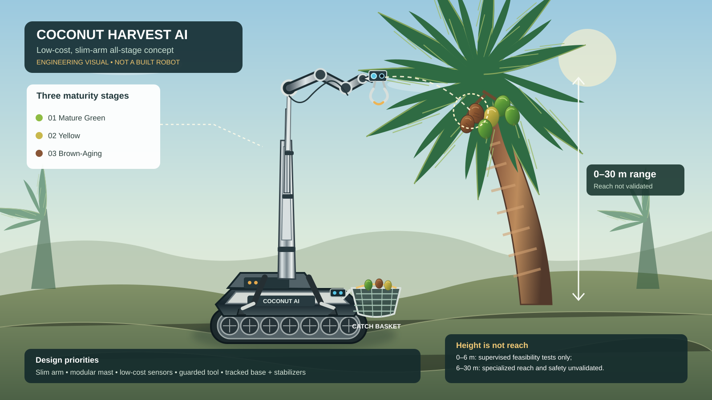

# Coconut Harvest AI

**Local-first coconut maturity assessment and human-reviewed harvest decision support.**

[English project page](https://pui89.github.io/coconut.html) · [ภาษาไทย](https://pui89.github.io/coconut-th.html) · [PUI89 portfolio](https://pui89.github.io/)

*Concept illustration only. It is not a built robot or evidence of a successful harvest.*

## What this product is

Coconut Harvest AI is an agricultural computer-vision project that helps orchard operators review visible coconut maturity and prepare traceable harvest-planning decisions. The first product milestone is software-based image assessment; a physical harvesting robot is a later research direction.

**ผู้ใช้งาน:** เกษตรกร ผู้ดูแลสวนมะพร้าว และหน่วยงานด้านการเกษตร  
**ประโยชน์หลัก:** ช่วยตรวจสอบภาพและประเมินลักษณะความแก่ของมะพร้าว พร้อมบันทึกความไม่แน่นอนและผลการตรวจสอบโดยมนุษย์

## Product-specific functions

- Review locally supplied orchard images and check image quality and source provenance.
- Use four visible assessment classes: **young green, mature green, yellow and brown**.
- Keep colour observations separate from biological maturity and harvest suitability; these require an appropriate human-reviewed definition.
- Record uncertain or obscured cases for human review instead of forcing a prediction.
- Prepare traceable assessment records for harvest planning.

## What is not established

- No approved real-orchard training dataset or held-out detector accuracy is established.
- No validated 0–30 m perception or reach capability is claimed; 0–30 m is a long-term research challenge.
- No autonomous cutting, tree climbing, physical harvesting robot or field safety performance is established.
- A concept illustration or software test is not evidence of harvesting performance.

## Current development status

**Implemented — software and evaluation-preparation foundation.** This label refers to software work only; it does not mean a physical harvesting system is implemented.

**Next evidence gate:** complete image-rights and provenance review, human annotation and QA, leakage-safe dataset splitting, then run a reproducible CPU evaluation. Report per-class precision, recall, F1, confusion counts, sample sizes, failure cases and measured runtime/RAM only after the evaluation has actually run.

## Product documentation

- [Software MVP product specification](docs/COCONUT_SOFTWARE_MVP_PRODUCT_SPEC.md)
- [Real-image validation execution gates](docs/COCONUT_REAL_IMAGE_VALIDATION_EXECUTION_GATES.md)
- [Four-class and 0–30 m validation roadmap](docs/FOUR_CLASS_0_30M_VALIDATION_ROADMAP.md)
- [Coconut maturity, location and harvest requirements](docs/COCONUT_MATURITY_LOCATION_HARVEST_REQUIREMENTS.md)

## Shared PUI89 engineering

Cross-product architecture, evidence contracts, safety, privacy, security, recovery, device interaction and localization requirements are maintained centrally in the [PUI89 Shared AI Core](https://github.com/Pui89/PUI89-Shared-AI-Core). This repository defines Coconut-specific tasks and validation; shared requirements are linked, not duplicated.

Current maturity labels and portfolio scope follow the [PUI89 Portfolio Alignment Register](https://github.com/Pui89/Pui89.github.io/blob/main/docs/PUI89_PORTFOLIO_ALIGNMENT_REGISTER_2026-11-18.md) and [Evidence-Based Development Maturity Standard](https://github.com/Pui89/Pui89.github.io/blob/main/docs/PUI89_DEVELOPMENT_STAGE_STANDARD.md).

**PUI89 has six active products.** Shared AI Core is infrastructure, not a seventh product. Extreme Flood Rescue AI is archived as a separate historical project.
