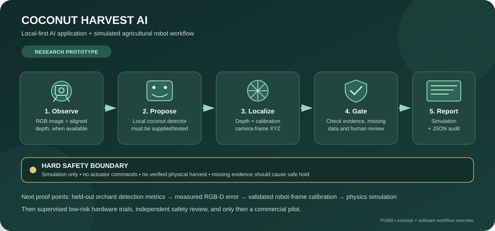
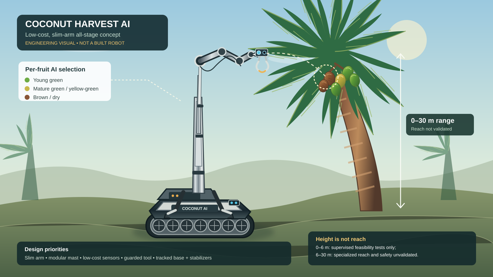

# Coconut Harvest AI

**AI-assisted coconut detection, harvest-stage decision support, and agricultural robotics concept**

Coconut Harvest AI is a local-first software and robotics project exploring how computer vision, conservative planning, and human supervision could support coconut inspection and harvesting workflows.

The project aims to help an operator review individual coconuts, choose an intended harvest stage, assess candidate targets, and investigate safe robot integration. It is **not a finished or field-validated harvesting machine**.



## Project at a glance

| Topic | Current position |
|---|---|
| Project type | Agricultural AI and robotics R&D |
| Available software | Rule-based planning agent, synthetic workflow demo, and manual image-review tools |
| Physical robot | Proposed concept; complete robot harvesting is not demonstrated |
| Real-image AI performance | Initial two-image baseline scored 0 precision and 0 recall at IoU ≥ 0.50; more data and reviewed labels are needed |
| Development approach | Local-first and free/open-source where practical |
| Immediate focus | Rights-cleared data, annotation quality, reproducible evaluation, and simulation |

**Explore:** [Run the prototype](#run-the-local-prototype) · [Current evaluation evidence](#current-evaluation-evidence) · [Development roadmap](#development-roadmap) · [Safety and limitations](#safety-and-limitations)


## Two parts of the project

<details>
<summary><strong>1. AI application — software for inspection and decision support</strong></summary>

The software side is intended to help a user review candidate coconuts, record the requested harvest stage, inspect uncertainty and safety checks, and produce an auditable planning report.

**Available now:** a rule-based planning agent, synthetic workflow demonstrations, and tools for manual image review and annotation quality checks.

**Not yet established:** reliable automatic coconut detection and maturity classification across real orchards, calibrated 3D fruit localization, or a validated model that can decide independently which fruit is ready to harvest.

</details>

<details>
<summary><strong>2. Physical AI robot — proposed machinery for future field work</strong></summary>

The robot concept shows how cameras and optional depth sensors could be combined with a mobile platform, a suitable reach mechanism, guarded cutting hardware, fruit retention or lowering, and independent safety controls.

**Current status:** concept and engineering workflow only. The repository does not demonstrate a complete physical robot performing validated coconut harvesting. The 0–30 m palm-height range is a long-term feasibility challenge, not a tested operating range.

</details>

**How they connect:** the application may recommend a candidate and a plan; a future robot would still need independently validated localization, reachability, hardware interlocks, human approval, and verified fruit collection. A software recommendation must never directly authorize a physical cut.


> **Current capability boundary:** this repository contains software prototypes, synthetic-data demonstrations, planning workflows, tests, and engineering concepts. Reliable all-stage detection, calibrated orchard-wide 3D localization, physical cutting and fruit collection, and autonomous operation at 0–30 m are not demonstrated capabilities. The 0–30 m range is a design challenge, not a proven robot reach specification.

## What the project includes

- **Local software workflow:** prototype code for reviewable candidate decisions and audit reports.
- **Harvest-planning agent:** a deterministic, rule-based tool that evaluates supplied candidate information; it does not detect fruit directly from image pixels.
- **Synthetic end-to-end demo:** exercises software gates and report generation without sending commands to physical actuators.
- **Real-image review workflow:** prepares a local manual-review sample and annotation sheet; it is not automatic detection.
- **Annotation overlay review tool:** a local OpenCV script renders existing boxes over original images for human QA; it does not certify annotations or detect fruit.
- **Robot concept and architecture:** outlines possible perception, target review, planning, and future hardware integration.
- **Free-first development:** prioritizes local tools and open-source workflows, with no paid API required for the rule-based agent.

## How the system is intended to work

```text
Camera / optional depth sensors
            |
            v
Input quality and sensor checks
            |
            v
Coconut detection and stage assessment
            |
            v
Operator selects harvest stage or survey-only mode
            |
            v
Candidate review: uncertainty, location, reach and obstacles
            |
            v
Human approval + independent safety checks
            |
            v
Future validated robot mechanism (not implemented here)
            |
            v
Outcome verification and audit record
```

Each visible coconut should be assessed separately, including fruit in mixed-stage bunches. The operator's selected stage filters candidates but never overrides uncertainty or safety checks. If evidence is missing, a target is unclear, reach is unverified, or a hazard is detected, the intended response is **SURVEY ONLY / NO CUT**.

## Coconut stages and per-fruit decisions

| Observation | Intended software response | Intended action policy |
|---|---|---|
| Young green | Propose a class only when supported by agreed, validated criteria | Consider only if the operator selected this class and safety checks pass |
| Mature green | Keep separate from young green; green colour alone does not prove maturity | Require validated maturity criteria and confirmation |
| Mature brown/dry | Propose a provisional class with evidence and uncertainty | Consider only if selected and all safety checks pass |
| Mixed-stage bunch | Assess each fruit individually | Filter each candidate separately |
| Occluded, blurry, cropped, or ambiguous fruit | Mark uncertain or request another view | No automatic cut |
| Damaged or abnormal fruit | Flag for review | Exclude from normal automatic harvesting |
| Survey-only request | Detect or record candidates without selecting a harvest target | No cutting |

These are intended classes and policies, not a claim that a reliable model for every class is already trained. Local growers should define criteria appropriate to cultivar and intended use.

## How the system handles each coconut

The intended workflow treats **each visible fruit as a separate candidate**, even when several coconuts share one bunch. The operator's choice determines which maturity category is requested; it does not force the AI to label an uncertain fruit or permit an unsafe cut.

1. **Capture and inspect the view.** Check image sharpness, lighting, occlusion, and whether the fruit is sufficiently visible. Request another view or mark the candidate uncertain when the image is inadequate.
2. **Detect and separate candidates.** A future validated vision model should assign a distinct candidate ID and bounding region to each visible coconut. Overlapping fruit must not be assumed to be one fruit or confidently split without evidence.
3. **Estimate maturity with uncertainty.** Use validated visual and, where available, additional sensor evidence. Colour alone is not enough to reliably distinguish every young, mature-green, brown, or dry coconut.
4. **Apply the operator's selection.** Keep candidates that match the requested stage; label non-matching candidates as “not selected.” Keep survey-only mode available when the operator wants inspection without harvesting.
5. **Check localization and reach.** Verify the candidate's 3D position, tool approach, obstacles, robot stability, and whether the actual mechanism is validated for that height. If any required measurement is missing or outside the verified operating envelope, return **NO CUT**.
6. **Require approval and safety interlocks.** Before any future physical cutting trial, require explicit human approval and independent hardware safety controls. The software prototype in this repository does not command a real cutter.
7. **Verify the outcome.** A future system should confirm whether the fruit was safely retained or lowered and record failures separately. A detection, plan, simulated action, or attempted cut must never be counted as a successful harvest by itself.

| Example situation | Candidate decision | Cutting policy |
|---|---|---|
| Requested mature-green fruit, clear image, validated maturity evidence | Eligible for further review | Only after all reach, safety, and approval gates pass |
| Young green fruit when brown/dry fruit was requested | Not selected | No cut |
| Brown-looking fruit with uncertain maturity | Uncertain; request another view or human review | No cut |
| Fruit partly hidden behind leaves or another coconut | Incomplete evidence | No cut |
| Fruit appears reachable but 3D position or tool clearance is unverified | Reachability unknown | No cut |
| Fruit is above the mechanism's verified reach envelope | Out of range | No cut |
| Operator chooses survey-only mode | Record/review candidate only | No cut |
| A cut is attempted but fruit collection is not confirmed | Outcome unverified | Do not report harvest success |

**Implementation status:** This section documents the intended system behaviour. It does not mean that all seven stages, an all-maturity detector, 3D localization, physical cutting, or harvest verification are already implemented. Current implementation details and evaluation evidence are listed in the status and benchmark sections below.

## Robot concept



*Conceptual design illustration — not a photograph of a built robot and not evidence of a successful harvest. Reach, stability, tool design, fruit retention, safe lowering, and operation in real orchards remain unvalidated.*

A future system may combine a mobile platform, camera and optional depth sensors, a suitable high-reach mechanism, a guarded cutting tool, fruit retention or lowering, emergency stops, and independent safety controls. A compact ground robot with a short arm cannot reach a 20–30 m palm crown by itself. Any high-reach design requires separate mechanical feasibility and safety validation.

### Tree-height scope

| Approximate height | Intended development scope | Current status |
|---|---|---|
| 0–3 m | Supervised perception and guarded test-rig feasibility | Candidate first test range; physical harvesting is not validated |
| 3–6 m | Study an engineered mast or lift | Concept/feasibility work |
| 6–12 m | Study purpose-built high-reach or climbing mechanisms | Not demonstrated |
| 12–20 m | Study specialist access, retention, and exclusion-zone requirements | Unvalidated engineering challenge |
| 20–30 m | Assess specialist solutions and alternatives to a ground-mounted arm | Outside demonstrated capability |

Detection at a height does not mean the robot can reach or harvest at that height. If reach, localization, stability, collision clearance, weather conditions, fruit capture, or the exclusion zone cannot be verified, the system must not initiate a cut.

## Implemented software vs. planned capabilities

| Area | Status |
|---|---|
| Rule-based harvest-planning agent | Code is available; evaluates supplied candidate fields and creates an auditable proposal |
| Synthetic end-to-end workflow | Available for software testing; synthetic inputs are not field evidence |
| Manual real-image review | Workflow and guide are available; this is not automatic detection |
| Coconut-specific model generalization | Not established; requires a larger, rights-cleared, independently reviewed dataset and held-out evaluation |
| Reliable all-stage maturity classification | Not established |
| Calibrated 3D localization and real robot reachability | Requires sensor calibration and independent validation |
| Physical cutting, collection, and autonomous harvesting | Not demonstrated |
| Safe operation at 0–30 m | Not demonstrated; long-term feasibility challenge |

## Current evaluation evidence

The first candidate batch was visually triaged across 30 images. Only two close-up images had first-pass boxes, totalling 15 reference boxes; the annotations still require independent review.

A simple OpenCV HSV-contour baseline was evaluated on those two images:

| Measure | Initial result |
|---|---:|
| Images evaluated | 2 |
| Reference boxes | 15 |
| Predicted boxes | 20 |
| Precision at IoU ≥ 0.50 | 0.000 |
| Recall at IoU ≥ 0.50 | 0.000 |
| F1 at IoU ≥ 0.50 | 0.000 |
| Mean CPU runtime | 15.12 ms/image |

This is a weak, simple non-ML smoke-test baseline, **not** a trained detector benchmark. Two images are insufficient to support generalization claims. The result is included transparently so the next experiments have a clear baseline.

**Reproducible evidence:** [raw benchmark report (JSON)](data/review_batch_2026-10-18/benchmark_report_v0.1.json) · [candidate review and annotation status](data/review_batch_2026-10-18/README.md) · [image-source rights audit](data/review_batch_2026-10-18/source_rights_audit_2026-10-19.csv) · [image hash manifest](data/review_batch_2026-10-18/image_sha256_manifest_2026-10-20.csv).

**Visual detection evidence status:** the repository currently has workflow/concept illustrations, but the initial benchmark does not establish successful real-image detection. A real annotated prediction overlay should be added only after the source image rights and annotations are verified and the model/script output can be reproduced. Do not use concept artwork as if it were an AI detection result.

Before training, the dataset still needs image-by-image source and licence checks, independent box and maturity-label review, a frozen manifest, duplicate checks, and leakage-safe splits grouped by scene/source.

## Run the local prototype

Use Python 3.10 or newer. Start with the standard-library planning agent, which does not require a paid API or model download.

```bash
git clone https://github.com/Pui89/Coconut-Harvest-AI.git
cd Coconut-Harvest-AI
python agents/harvest_planning_agent.py
python agents/harvest_planning_agent.py --input examples/agent_candidates.example.json --output agent_report.json
```

On Windows, see [Free Windows Setup](docs/FREE_WINDOWS_SETUP.md).

### Synthetic end-to-end demo and tests

```bash
python -m pip install -e ".[dev]"
python demo_end_to_end.py
python -m pytest
```

These commands exercise the repository's software workflow and tests. Check the dependency and environment notes before installing optional packages. The demo uses synthetic or supplied evidence; it does not establish real-image detection accuracy or authorize physical robot control.

### Manual real-image review

See [Real Image Test Workflow](docs/REAL_IMAGE_TEST_WORKFLOW.md). The optional script can download two reference photographs from Wikimedia Commons and prepare a local review CSV plus source/licence notes. Review each source's licence and attribution requirements before reuse. This workflow is manual review, not automatic detection.

## Development roadmap

1. Verify the source, licence, attribution, and hash of every candidate image.
2. Independently review annotations and maturity labels; exclude unclear or unsuitable images.
3. Build a sufficiently varied dataset and create leakage-safe train/validation/test splits.
4. Train and evaluate a local baseline on held-out images; report per-class precision, recall, F1/mAP, failure cases, and runtime.
5. Test uncertainty handling, occlusion, false-safe reachability decisions, and stop conditions.
6. Develop and validate a simulation model for the robot geometry and reach envelope.
7. Consider supervised, low-height, non-cutting hardware trials only after documented simulation, risk assessment, and independent safety gates pass.

## Safety and limitations

- This repository is a development prototype, not a field-ready agricultural machine.
- Do not connect prototype software directly to motors, cutters, or manipulators.
- A software approval or simulated task is not proof that a physical action is safe.
- Any future physical trial needs independent safety controls, emergency stop, a clear exclusion zone, supervised operation, and documented risk assessment.
- A successful harvest must be independently verified; a detection, plan, animation, or attempted cut is not a harvest success.
- No claims are made for guaranteed labour savings, safety improvement, yield, commercial return, or reliable performance across all coconut stages.

## Documentation

- [Product brief](docs/PRODUCT_BRIEF.md)
- [Project status](docs/PROJECT_STATUS_2026-10-18.md)
- [Validation matrix](docs/VALIDATION_MATRIX.md)
- [Complete-system blueprint](docs/COMPLETE_SYSTEM_BLUEPRINT.md)
- [Coconut-stage roadmap](docs/COCONUT_STAGE_ROADMAP.md)
- [0–30 m tree-height feasibility plan](docs/TREE_HEIGHT_FEASIBILITY_0-30M.md)
- [Candidate image triage](docs/CANDIDATE_IMAGE_TRIAGE_2026-10-20.md)
- [Evaluation benchmark](docs/EVALUATION_BENCHMARK.md)
- [End-to-end simulation guide](docs/END_TO_END_SIMULATION.md)
- [Robot workflow guide](docs/END_TO_END_ROBOT_WORKFLOW.md)
- [Planning agent guide](agents/README.md)
- [Cost safety and billing policy](docs/COST_SAFETY_AND_BILLING.md)
- [CI and test runs](https://github.com/Pui89/Coconut-Harvest-AI/actions)

## Collaboration

Feedback and collaboration are welcome from coconut growers, agricultural cooperatives, agricultural machinery developers, robotics engineers, and open-source contributors. Useful contributions include rights-cleared orchard imagery, annotation review, reproducible benchmarks, simulation testing, and safety-focused engineering review.

## Licence and third-party assets

Check the repository's licence and each third-party dataset, image, model, and dependency licence before reuse. Inclusion in a demo or contact sheet does not automatically grant redistribution or training rights.
