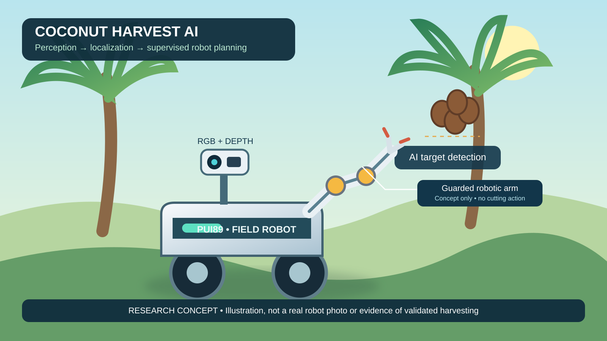
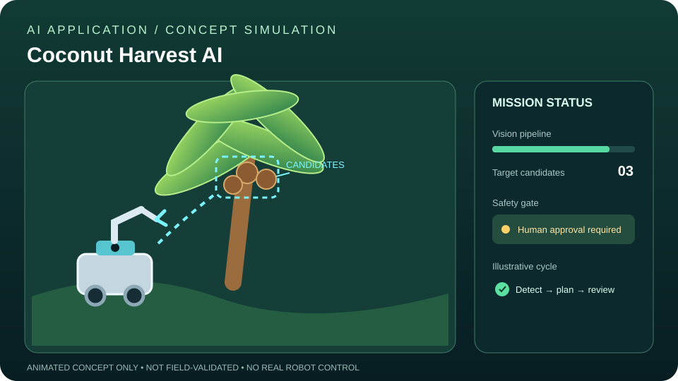
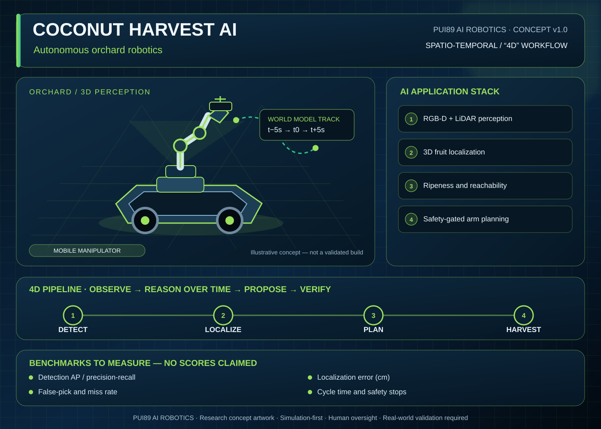
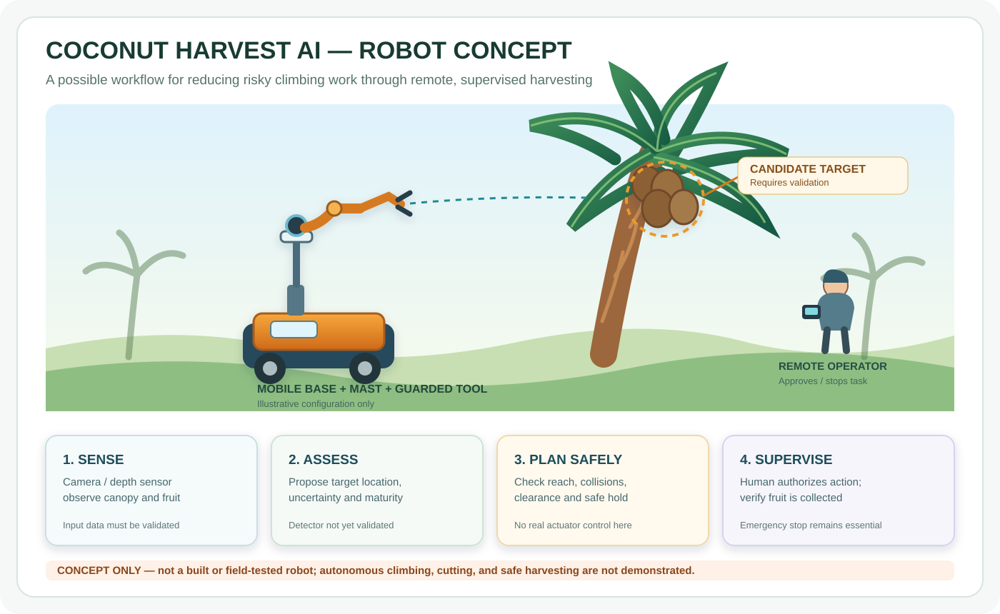

# Coconut Harvest AI Application

## Robot concept illustration



*Original concept artwork—not a real robot photograph or evidence of validated physical harvesting.*


> **Complete-system architecture and acceptance gates:** [COMPLETE_SYSTEM_BLUEPRINT.md](docs/COMPLETE_SYSTEM_BLUEPRINT.md). This is a build-and-validation plan, not a claim of field-validated harvesting.
> **Current validation matrix:** [VALIDATION_MATRIX.md](docs/VALIDATION_MATRIX.md) — implementation evidence, automated checks, and remaining unvalidated capabilities.

> **A local-first AI application and simulation-first agricultural robot research project.** The goal is to explore whether computer vision, RGB-D localization, conservative task planning, and human-supervised safety gates can support safer coconut harvesting. This is a research prototype—not a finished or field-validated harvesting robot.


[Detailed project status, checks, next steps and future plan](docs/PROJECT_STATUS_2026-10-18.md)

## Product brief

See [docs/PRODUCT_BRIEF.md](docs/PRODUCT_BRIEF.md) for a concise description of the problem, current evidence, intended audiences, demonstration plan and milestones for potential partners or award applications.

## Commercial and award readiness

See [docs/COMMERCIAL_READINESS_ROADMAP.md](docs/COMMERCIAL_READINESS_ROADMAP.md) for product stages, evidence required before selling, immediate priorities, acceptance gates and award-application preparation. The roadmap distinguishes verified software checks from unvalidated real-world capability; it does not claim commercial readiness or market leadership.

## Latest status update — 18 October 2026

- **Successful:** Python CI passed on 3.10/3.11/3.12 in [run 39096443251](https://github.com/Pui89/Coconut-Harvest-AI/actions/runs/39096443251); candidate collection generated 30 image candidates and provenance/review files; Pages deployment passed. This verifies automated software checks only—not detector accuracy or physical harvesting.
- **Batch triage update:** all 30 files were readable (29 JPEG, 1 PNG) with no byte-identical duplicates. Full-resolution review and Commons source-page licence/credit checks are complete for priority candidates 0001, 0002 and 0004 only; their box labels and QA remain pending. The other 27 images still need individual review. This is not a labelled dataset. See the [candidate batch report](docs/CANDIDATE_IMAGE_BATCH_2026-10-18.md).
- **Continuing:** full-resolution image and licence review, human annotation, dataset QA and leakage-safe splits.
- **Next:** download the temporary candidate artifact before 25 October 2026; label approved images; run dataset audits; then perform a reproducible local baseline and frozen held-out evaluation.
- **Future:** measure detection and RGB-D localization, validate robot geometry/collision/safe-stop behavior in simulation, and only later consider supervised non-cutting hardware tests.
- **Corrections:** no trained-detector metrics, RGB-D benefit, safe physical motion or real harvesting are established. CI success and concept artwork are not field-performance evidence. Free/local-first; no paid cloud service is required.


## Live project overview — 18 October 2026

This table is the current evidence-based status, not a claim that the full robot is complete.

| Area | Status now | Evidence / boundary |
|---|---|---|
| Application and workflow prototype | **Implemented prototype** | Local detector adapter, RGB-D proposal/localization interface, simple IoU tracking baseline, decision gates, simulation workflow and JSON audit reporting are present in the repository. |
| Software regression checks | **Partly verified by CI** | The recent free-image-candidate workflow and GitHub Pages deployment succeeded. These check those workflows only; check the [Actions page](https://github.com/Pui89/Coconut-Harvest-AI/actions) for the latest application/test workflow status. |
| Dataset preparation | **Tools implemented; dataset not yet validated** | Free candidate-image collector, licence/provenance gallery, offline bounding-box annotator, YOLO conversion, reviewed dataset builder and split-leakage audit are available. Candidate images still need human review, licence checks and labels. |
| Trained coconut detector | **Not yet evidenced** | No verified held-out benchmark result is claimed here. Do not treat a model adapter, demo, candidate gallery or synthetic fixture as proof of accurate detection. |
| RGB-D localization and tracking | **Prototype only** | Interfaces and a simple tracking baseline exist; real camera calibration, depth quality and localization error must be measured independently. |
| Robot planning and physical harvesting | **Not validated** | No claim of safe autonomous cutting, successful physical harvesting, orchard field trials or production readiness. No actuator commands are authorized by the current software workflow. |

### What has succeeded
- The repository contains separable application and robot-workflow components, automated tests, synthetic fixtures and audit-oriented reporting.
- Fail-closed decision gates are intended to reject missing or invalid evidence instead of treating it as a safe target.
- Free-first dataset preparation and offline annotation tools are in the repository; the workflow does not require a paid inference API.
- The latest candidate-image collection workflow completed successfully and collected **30 candidate images**; its gallery builder recorded 30 candidate records and the workflow uploaded a 15.6 MB artifact containing the images and provenance/review files. [View run and download the artifact](https://github.com/Pui89/Coconut-Harvest-AI/actions/runs/39092214196). These are **unreviewed candidates**, not a labelled dataset; some search results may be irrelevant, and some downloads were rate-limited. The artifact expires on 25 October 2026 unless downloaded beforehand.

### What is in progress
- Turn the candidate-image tools into a human-reviewed, licence-checked, labelled dataset.
- Create group-separated train/validation/test splits and audit for leakage before model training.
- Run a reproducible local baseline training and held-out evaluation; save commands, package versions, dataset provenance, checkpoint hash, raw outputs and failure examples.
- Measure localization/tracking separately from detection, then test the end-to-end workflow in simulation with explicit safety stops.

### Next actions, in order
1. Download the generated [coconut-image-candidates artifact](https://github.com/Pui89/Coconut-Harvest-AI/actions/runs/39092214196) before it expires; review the images and source licences. The collection workflow has already run on GitHub, so no local collection command is needed for this first batch.
2. Label only relevant, clearly visible coconuts using the [offline annotator](tools/coconut_annotator.html); exclude irrelevant or ambiguous images.
3. Build and audit dataset splits with the scripts linked in [training documentation](training/README.md). Keep image datasets and model weights out of Git.
4. Train a local baseline only after checking the base checkpoint licence and available hardware; freeze the test split before tuning.
5. Publish a results report with dataset size, split counts, precision, recall, mAP where applicable, false positives/negatives, latency, confidence threshold, hardware and known failure cases. If no run has been performed, mark results **not measured** rather than estimating numbers.
6. Validate RGB-D calibration and localization error; then improve robot-model geometry, reachability, collision checks and stop/fault behaviour in simulation.
7. Consider a guarded, non-cutting hardware feasibility test only after documented risk review and qualified supervision.

### Future target
A research-grade, locally runnable agricultural AI system with independently measured perception, localization and simulation performance; transparent safety limits; and a controlled path toward supervised field trials. Commercial claims about speed, safety, cost savings or superiority over other systems must wait for fair, documented comparisons.

**Current honest conclusion:** useful prototype and engineering/test scaffolding are in place. The key missing evidence is a real, reviewed dataset plus a trained detector's held-out results, followed by validated spatial and robot-safety tests.


## Project status at a glance

| Status | What it means today |
|---|---|
| **Implemented prototype** | Local detector adapter, camera-frame RGB-D localization, simple IoU tracking baseline, configurable decision gates, simulated task workflow, and JSON audit reporting are present in the codebase. |
| **Testable with synthetic inputs** | A deterministic simulation workflow and clearly labelled synthetic fixtures let developers test decisions without a physical robot or paid cloud inference. |
| **Automated CI** | The current feature branch passed both GitHub Actions jobs: the focused/application test workflow and the dedicated end-to-end simulation workflow. This validates software tests, not real-orchard accuracy or robot safety. |
| **Not demonstrated** | Autonomous physical harvesting, safe palm climbing, real cutting/grasping, field success rate, and production readiness. |

### What has been achieved

- Built separate AI-application and robot-workflow components that can be inspected and tested.
- Added fail-closed checks so missing or invalid evidence should not be treated as a safe robot target.
- Connected local vision proposals to a simulation-only workflow through an explicit calibration/evidence interface.
- Added unit and integration tests, synthetic fixtures, documentation, and a proposed CI test path.
- Added an offline browser-based coconut bounding-box annotator, a JSON-to-YOLO converter, and a train/validation/test leakage audit script.
- Kept the software local-first: no paid inference API, no automatic model-weight download, and no physical actuator commands.

### What is being worked on

- Keeping both GitHub Actions workflows green as the branch changes.
- Rechecking the demo and local run instructions from a clean checkout.
- Separating synthetic examples from measured results and documenting each limitation.
- Preparing a practical benchmark for detection, localization, tracking, safety rejection, and task simulation.

### What comes next

1. **Reproducibility:** keep the passing focused and repository test suites repeatable from a clean environment.
2. **Real-image benchmark:** assemble a permitted, labelled orchard dataset and report held-out detection precision/recall and failure cases.
3. **Spatial validation:** measure RGB-D localization error and validate camera-to-robot calibration; never use the synthetic identity transform for hardware.
4. **Physics simulation:** validate robot geometry, joint limits, reachability, collision checking, tool envelope, and safe-stop scenarios in a simulator.
5. **Controlled prototype:** only after independent risk review, test a guarded, non-cutting rig under qualified supervision.
6. **Commercial pilot:** compare measured safety, successful collection rate, cycle time, fruit damage, operator intervention, and total cost against the current harvesting process.

## Why a farm or company might evaluate this project

The possible value is a local-first, auditable, human-supervised workflow that can be tested before committing to expensive robot hardware. Its intended direction is to help operators assess targets and plan work while reducing the need for some hazardous climbing tasks. These benefits are hypotheses, not measured outcomes.

**Honest buying position:** this project is not ready to be sold as a functioning autonomous coconut-harvesting robot. A suitable current partner would be a research group, farm, or company interested in a feasibility study, data collaboration, or simulation benchmark. No claim of being better, faster, cheaper, or safer than another robot is justified until an agreed comparison is measured.

- [Buyer value, competitive comparison, and evidence required before a pilot](docs/BUYER_VALUE_AND_COMPETITIVE_POSITIONING.md)
- [End-to-end workflow and safety limitations](docs/END_TO_END_ROBOT_WORKFLOW.md)
- [Application setup and local detector requirements](apps/pui89_app/README.md)
- [Development roadmap](docs/DEVELOPMENT_ROADMAP.md)
- [Reproducible benchmark protocol](docs/REPRODUCIBLE_BENCHMARK_PROTOCOL.md)
- [One-command local baseline training and held-out evaluation](scripts/run_coconut_baseline.ps1)
- [Safety state machine and release gates](docs/SAFETY_STATE_MACHINE.md)
- [Research evidence matrix: implemented vs. unvalidated](docs/RESEARCH_EVIDENCE_MATRIX.md)
- [Cost and billing policy](docs/COST_SAFETY_AND_BILLING.md)
- [First candidate-image batch: provenance, preliminary visual triage, and required review](docs/CANDIDATE_IMAGE_BATCH_2026-10-18.md)

---

## Free local Hugging Face model plan

This repository's recommended local model, intended tasks, licence checks, setup notes, and no-surprise-billing rules are documented in **[HUGGINGFACE_LOCAL_MODELS.md](docs/HUGGINGFACE_LOCAL_MODELS.md)**.

**Cost boundary:** the plan uses downloaded local weights only; it does not require paid Hugging Face inference, cloud GPUs, paid notebooks, or a subscription. Model integration and performance must be verified by running tests locally.


## Quick start: create a free candidate-image review gallery (Windows)

This is the shortest practical route to start without owning coconut photos. It downloads a **small candidate batch** from Wikimedia Commons and builds a local gallery so you can reject irrelevant images and verify each source licence. It does not automatically label images or create a validated orchard dataset.

~~~powershell
# First change into the cloned repository folder (the folder containing README.md)
cd C:\\path\\to\\Coconut-Harvest-AI

python -m pip install -r tools/requirements-data.txt
python tools/collect_commons_coconuts.py --out data/commons_candidates --limit 30
python tools/build_candidate_gallery.py --collection-dir data/commons_candidates
Start-Process (Resolve-Path data/commons_candidates/review_gallery.html)
~~~

**Important on Windows:** run the commands above in **PowerShell**, not Command Prompt (`cmd.exe`), because `Start-Process` is a PowerShell command. Replace `C:\\path\\to\\Coconut-Harvest-AI` with your actual repository path. Before running anything, confirm you are at the repository root by running `dir`; you should see `README.md`, `apps`, `tools`, and `training`. If Python says `No module named 'apps'`, or says it cannot open `tools\\...`, you are in the wrong folder. In Command Prompt, you can open PowerShell by typing `powershell`, then change to the repository folder with `cd /d "C:\\path\\to\\Coconut-Harvest-AI"`. Do not run these repository commands from `C:\\Users\\ACER` unless that is actually where the repository's files are.

The downloaded images and gallery stay on your computer. The collector writes `provenance.csv` with source URLs and licence metadata. Open each original file page and verify the exact licence/attribution terms before using the image, especially for redistribution or commercial use. Search results may include non-orchard images; discard those rather than pretending they represent harvesting conditions.

**Then label reviewed images:** open [the offline annotator](tools/coconut_annotator.html) from a local checkout, choose the reviewed image files, draw a box around every clearly visible coconut, and export the JSON. Use the [reviewed dataset builder](training/build_dataset_from_annotations.py) to package the images and labels into reproducible group-separated train/validation/test splits after recording human review and licence verification. Keep the dataset and weights out of Git.

**Current collection status:** GitHub Actions has collected the first 30 candidate images and built a review gallery. The generated artifact is temporary (7-day retention). A valid dataset and real benchmark still require image relevance review, licence verification, annotation, independent group-separated train/validation/test splits, and an actual training/evaluation run.

## Start without your own photos

Use the free Wikimedia Commons collector to build a candidate image collection with recorded licence and attribution metadata: [collection guide](docs/FREE_IMAGE_COLLECTION_GUIDE.md), [collector script](tools/collect_commons_coconuts.py). It does not create labels automatically and it does not guarantee that each image is an orchard scene. Review every image and licence, then use the [offline browser annotator](tools/coconut_annotator.html) and [YOLO conversion script](tools/convert_annotations_to_yolo.py) to prepare reviewed labels before training.

## Train and evaluate a real coconut detector

Before reporting results, create a reproducibility manifest that records the dataset YAML checksum, configured split paths and image counts, Git commit, package versions, available GPU, and (if supplied) checkpoint SHA-256. From the repository root:

```powershell
python training/create_experiment_manifest.py --data "C:\datasets\coconut\coconut.yaml" --weights "runs\coconut\train\weights\best.pt" --experiment-id "coconut-test-v1" --output "reports\coconut-test-v1-manifest.json"
```

After evaluation, cross-check the manifest against the test report with [the provenance audit](training/audit_experiment_report.py):

```powershell
python training/audit_experiment_report.py --manifest "reports\coconut-test-v1-manifest.json" --report "reports\coconut_test_report.json" --output "reports\provenance_audit.json"
```

A non-zero exit means one or more provenance checks failed; inspect the JSON and resolve mismatched checksums or missing fields before sharing results. This verifies file identity consistency only, not label correctness or real-world performance.

The manifest is provenance metadata, **not an experiment result**. It does not validate image licences or labels, and it does not run training or evaluation. See [the script](training/create_experiment_manifest.py). The file is generated locally; review it before sharing because it includes local paths and environment details.

## Train and evaluate a real coconut detector

The local training, offline annotation, YOLO conversion, and held-out evaluation workflow is documented in [training/README.md](training/README.md). Tools include the [Commons image collector](tools/collect_commons_coconuts.py), [local review-gallery builder](tools/build_candidate_gallery.py), [offline annotator](tools/coconut_annotator.html), [reviewed dataset builder](training/build_dataset_from_annotations.py), [label QA preview gallery](tools/preview_yolo_labels.py), [annotation converter](tools/convert_annotations_to_yolo.py), and [dataset split audit](training/audit_dataset_splits.py). Dataset access/licensing and the current free-data search are documented in [FREE_DATASET_AND_TRAINING_WORKFLOW.md](docs/FREE_DATASET_AND_TRAINING_WORKFLOW.md).

These scripts do not include a trained checkpoint or claim accuracy. You must supply a permitted labelled dataset and an existing local base checkpoint, then run training and the frozen test evaluation yourself. The existing [RGB-D proposal pipeline](apps/pui89_app/local_first_pipeline.py) connects a local coconut model to a review-only JSON proposal; calibrated depth and safety evidence remain necessary, and no hardware commands are sent.

## Local development on an RTX 3050 laptop

The hardware-aware, zero-cost-first plan is in [LOCAL_EXPERIMENT_PLAN_RTX3050.md](docs/LOCAL_EXPERIMENT_PLAN_RTX3050.md). A read-only environment checker is available at [scripts/check_local_environment.py](scripts/check_local_environment.py); it does not install packages, download models, use the network, or change system settings. The plan is tailored to a reported RTX 3050 Laptop GPU with 4 GB VRAM and 16 GB system RAM. It distinguishes the existing synthetic prototype from future model experiments and measured results.

## Try the Interactive AI Application Example

Want to see an example instead of only reading about the concept? The repository includes a small Streamlit demo where you can upload an orchard photo for display, adjust example sensor/coconut evidence, run the decision-support rules, and download a JSON report.

**[Open the web demo source and setup instructions](apps/pui89_app/README.md)** · [View the interactive demo code](apps/pui89_app/web_demo.py)

Run it locally from the repository root:

```bash
python -m pip install -r apps/pui89_app/requirements.txt
streamlit run apps/pui89_app/web_demo.py
```

**Demo limitation:** the uploaded photograph is displayed for context but is not automatically analysed by a trained detector. The output is based on manually entered values and illustrative rules; it is not a real-world harvesting result or robot control system.


## How the AI Application Works

The **AI application** is the software layer that runs on a computer. It takes orchard images and, when available, depth and robot-state data; checks input quality; analyses candidate coconuts; records uncertainty; and produces a reviewable harvest-plan proposal and JSON audit report.

```text
Orchard image + optional depth / robot-state data
                    |
                    v
         Input quality and sensor checks
                    |
                    v
          AI vision / target proposals
                    |
                    v
      Spatial and temporal evidence (3D/4D)
                    |
                    v
 Harvestability + uncertainty + missing-data checks
                    |
                    v
            Candidate plan proposal
                    |
                    v
       Safety checks, review and JSON report
```

**AI application concept image**





**Real-world image used as application context**


*Photograph by Paul The Writer, shared under [CC0 1.0](https://creativecommons.org/publicdomain/zero/1.0/). [Original image and licence](https://commons.wikimedia.org/wiki/File:Fruiting_Coconut_Palm_Canopy.jpg). This is a real-world visual reference, not an image processed or evaluated by the current prototype.*

**What it does and does not prove:** the repository provides a simulation-first software prototype and concept visualizations. Coconut-specific detection accuracy, ripeness assessment, and real-time 3D/4D tracking require representative labelled data and measured validation. The application proposes and reports; the documented demo does not directly control physical actuators.

---

## How the AI Robot Works

The **AI robot** is the proposed physical or simulated machine that could use the application's proposals. In a future validated system, cameras and other calibrated sensors observe the tree and workspace; perception estimates target locations; a planner proposes a movement; and an independent safety layer checks that movement before an authorized controller could execute it.

```text
RGB / depth / optional LiDAR + robot-state sensors
                    |
                    v
        Perception and target tracking
                    |
                    v
             3D / 4D scene model
                    |
                    v
        Harvest task / motion proposal
                    |
                    v
 Independent collision and safety validation
                    |
                    v
      Authorized controller (future stage)
                    |
                    v
        Verify outcome and record evidence
```


**Real-world image of the harvesting task**


*Photograph by Rudolph A. Furtado, shared under [CC0 1.0](https://creativecommons.org/publicdomain/zero/1.0/). [Original image and licence](https://commons.wikimedia.org/wiki/File:Coconut_Plucker_plucking_coconuts_on_a_tree_in_Mumbai..JPG). This shows human harvesting for real-world context; it is not a robot trial or proof of autonomous harvesting.*

**Current robot status and safety boundary:** the repository includes software prototypes, simulation assets and robot concept/model files. It does not establish that a physical robot can safely climb a palm, cut or grasp coconuts, avoid every collision, or harvest autonomously in an orchard. Do not connect this prototype directly to physical motors, cutters or manipulators. Any future hardware work needs calibrated sensors, independent collision/workspace validation, emergency-stop testing, supervised low-risk trials and a documented safety review.

---

## How the Coconut Harvest AI Application Works

Coconut Harvest AI is a **simulation-first research prototype** for exploring how computer vision, spatial reasoning, harvestability assessment, and safety checks could support coconut harvesting. The workflow below explains the intended system and distinguishes existing prototype behavior from work that still needs real-world validation.

### End-to-end workflow

```text
Orchard RGB image + optional depth / LiDAR / robot-state data
                         |
                         v
              1. Input and sensor checks
       Check data quality, health, and time alignment
                         |
                         v
              2. Perception proposal
       Extract visual features and identify candidate targets
       Coconut-specific detection requires validated model/data
                         |
                         v
              3. Spatial and temporal reasoning
       Associate depth with targets; estimate 3D position
       Track target state over time when suitable data are available
                         |
                         v
              4. Harvestability assessment
       Review ripeness evidence, visibility, confidence,
       reachability, clearance, and missing/contradictory inputs
                         |
                         v
              5. Plan proposal
       Generate a candidate approach / waypoint sequence
                         |
                         v
              6. Deterministic safety gate
       Reject unsafe, incomplete, or unverified proposals;
       require independent collision and workspace validation
                         |
                         v
              7. Report and operator review
       Save decision status, reasons, and an auditable JSON report
```

### What each stage does

1. **Input:** Start with synthetic scenes or recorded orchard images. RGB-D cameras and LiDAR can be integrated, but sensor calibration and timestamp synchronization must be checked before trusting spatial measurements.
2. **Perception:** A vision model extracts features and may propose coconut/tree targets. A model architecture or a generic pretrained checkpoint alone does not prove accurate coconut detection; this requires labelled, representative orchard data and held-out evaluation.
3. **3D/4D scene understanding:** Depth and sensor calibration can help estimate target locations in 3D. The 4D layer refers to tracking how targets and the robot scene change over time; it is not a claim that a validated real-time 4D system is already operating in an orchard.
4. **Harvestability:** The system can consider supplied evidence such as ripeness, occlusion, localization confidence, reachability, clearance, and tracking stability. A score is only as reliable as its inputs and validation.
5. **Planning:** The planner proposes candidate waypoints or a harvesting sequence. A proposed path must not be described as collision-free unless an independent, validated collision checker has verified it.
6. **Safety gate:** The prototype can reject proposals and use conservative states such as `SAFE_HOLD`, `BLOCKED`, or `PROPOSAL_APPROVED_NOT_EXECUTED`. Approval means only that configured software checks passed; it is not authorization to move a physical robot.
7. **Reporting:** The end-to-end demo emits a JSON audit report containing the decision status and reasons. The documented demo does **not** send actuator commands.

### Run the prototype locally

From the repository root:

```bash
python -m pip install -e ".[dev]"
python demo_end_to_end.py
python -m pytest
```

See the [end-to-end simulation guide](docs/END_TO_END_SIMULATION.md), [pipeline implementation](src/coconut_harvest_robot/end_to_end.py), [demo script](demo_end_to_end.py), and [evaluation benchmark](docs/EVALUATION_BENCHMARK.md).

### Current implementation vs. future validation

| Area | What this repository currently supports | What is still needed |
|---|---|---|
| Software workflow | Prototype pipeline, configured checks, and JSON reporting | Reproducible tests across representative scenarios |
| Vision | Neural feature-processing prototype | Labelled orchard dataset, trained/validated coconut detector, held-out metrics |
| Harvestability | Assessment of supplied evidence and configured scores | Ground-truth maturity labels and evaluation of decision quality |
| 3D/4D reasoning | Prototype spatial/temporal architecture | Calibrated sensors, measured localization error, validated target tracking |
| Motion planning | Candidate trajectory/waypoint proposal | Independent collision checking, robot-kinematics and physics validation |
| Robot execution | Documented integration path and simulation assets | Validated ROS 2/controller integration, hardware tests, risk assessment |
| Field harvesting | Not demonstrated by the software demo | Supervised field trials and documented success, failure, and safety results |

### Safety and evidence limits

This is **not yet a validated autonomous harvesting robot**. The demo uses synthetic inputs and/or explicitly supplied evidence rather than proving that a trained model correctly detects and harvests coconuts in real orchards. Concept images and animations illustrate the idea; they are not experimental results. Do not connect this prototype directly to physical motors, cutters, or manipulators. Before any hardware trial, require calibrated sensors, independent collision/workspace checks, emergency-stop verification, supervised low-risk testing, and documented safety review.


### Platform scope: AI application + embodied robotics

**This platform is designed to support both an AI application and embodied AI in a robot.** These are two connected layers of one research platform:

- **AI application layer (runs on a computer):** orchard-image/data processing, coconut target detection and tracking experiments, harvestability assessment, uncertainty reporting, visualization, and reviewable harvest-plan proposals.
- **Embodied robotics layer (robot-facing architecture):** connect perception and planning to a simulated or physical agricultural robot through interfaces such as ROS 2, with localization, 3D scene understanding, reachability/collision checks, manipulation planning, and independent safety supervision.
- **Shared pipeline:** sensor/data quality → perception and tracking → 3D/temporal world model → task planning → safety validation → operator review and audit.

The software application can be developed and evaluated on a computer without robot hardware. The embodied layer is the intended robotics integration path; **do not interpret this architecture or concept artwork as proof that physical robot integration, safe manipulation, or field harvesting has been completed or validated.** Begin with synthetic/recorded data and simulation, then require measured benchmarks and independent safety validation before hardware trials.


### Quick start

Clone the renamed repository and install the project dependencies:

```bash
git clone https://github.com/Pui89/Coconut-Harvest-AI.git
cd Coconut-Harvest-AI
python -m pip install --upgrade pip
python -m pip install -e ".[dev]"
python demo_end_to_end.py
python -m pytest
```

The end-to-end demo and tests are intended for local development with the project's documented inputs. Start with synthetic or recorded data; do not connect the prototype directly to physical actuators or use it as the sole basis for consequential decisions.

**Workflow:** sensor/data quality checks → perception and multimodal evidence → 3D/temporal scene representation → uncertainty and unknown-case handling → reviewable plan or screening proposal → audit record.

**Documentation:** [End-to-end simulation guide](docs/END_TO_END_SIMULATION.md) · [Evaluation benchmark](docs/EVALUATION_BENCHMARK.md)

## PUI89 AI Robotics Platform

**Autonomous multimodal embodied-AI platform for orchard harvesting.**

This repository is one vertical implementation of the **PUI89 AI Robotics** platform for agriculture. The common architecture is:

```text
Multimodal Sensors
      ↓
Quality / Health Gate
      ↓
Perception + Tracking
      ↓
3D / 4D World Model
      ↓
Uncertainty + OOD
      ↓
Foundation-Model Reasoning
      ↓
Task Planning
      ↓
Deterministic Safety Supervisor
      ↓
ROS 2 / Robot Control
      ↓
Telemetry / Evidence
      ↓
MLOps / Fleet Learning
```

### Product tiers

- **PUI89 Research** — universities, robotics competitions, researchers
- **PUI89 Professional** — farms, plantations, agricultural operators
- **PUI89 Enterprise** — large corporations, governments, logistics, ports, infrastructure

### Cross-environment research

The same perception/world-model/uncertainty/safety interfaces are designed to transfer between agriculture, disaster response and security/inspection. Transfer must be measured with the repository benchmark; it is not assumed from architecture alone.

- [Optional DINOv2 + Anomalib integration, end-to-end verification and tests](docs/OPEN_SOURCE_VISION_INTEGRATION.md)
- [ROS 2 + Nav2 + Gazebo Sim + Open3D integration guide and environment preflight](docs/ROBOTICS_STACK_INTEGRATION.md)

### Evidence standard

This project separates **targets, prototypes and measured results**. Production or field-validation claims require reproducible benchmark evidence, failure testing, and documented safety validation.

See:
- [PUI89 Benchmark](docs/PUI89_BENCHMARK.md)
- [Cross-Environment Transfer Benchmark](docs/PUI89_TRANSFER_BENCHMARK.md)
- [Product Tiers](docs/PUI89_PRODUCT_TIERS.md)
- [Failure and UNKNOWN Protocol](docs/PUI89_FAILURE_AND_UNKNOWN_PROTOCOL.md)
- [MLOps Model Lifecycle](docs/PUI89_MLOPS_MODEL_LIFECYCLE.md)
- [Research, Competition and Commercial Evidence](docs/PUI89_RESEARCH_COMPETITION_INVESTOR.md)
- [12-Month Roadmap](docs/PUI89_12_MONTH_ROADMAP.md)
- [Cost Safety and Billing Policy](docs/COST_SAFETY_AND_BILLING.md)

## Robot concept and development status

PUI89 Coconut Harvest Robot is a **simulation-first research concept** for investigating safer coconut harvesting. The proposed architecture compares a trunk-climbing platform with alternatives such as a ground-based arm. The mechanical approach is not yet validated; physical climbing and cutting must not be assumed to work.


### 3D / 4D concept visualization


These repository graphics are concept visualizations, not evidence of a completed or field-tested robot. Any animation illustrates a proposed trajectory rather than measured robot performance.

- [Concept design, subsystems, safety boundaries and acceptance criteria](docs/CONCEPT_DESIGN.md)
- [Simulation-first development roadmap and release gates](docs/DEVELOPMENT_ROADMAP.md)
- [Robot description (URDF)](robots/coconut_harvester.urdf)
- [Simulation demos](sim/)
- [Evaluation benchmark](docs/EVALUATION_BENCHMARK.md)

### End-to-end simulation demo

Run the safety-gated software workflow with synthetic orchard inputs:

~~~bash
python -m pip install -e ".[dev]"
python demo_end_to_end.py
python -m pytest
~~~

**Workflow stages**
1. **Sensor health:** evaluate sensor quality and timestamp alignment; unhealthy or unsynchronized inputs trigger a safe hold.
2. **Perception proposal:** process RGB and depth tensors through the current prototype pipeline.
3. **Harvestability review:** score explicitly supplied evidence for perception/localization confidence, ripeness, reachability, clearance, occlusion, and tracking stability.
4. **Safety gate:** reject proposals without independent collision validation or when other configured safety conditions fail.
5. **Audit report:** emit a JSON report with status, decision reasons, prototype trajectory waypoint count, and the actuator-command invariant.

**Possible report status:** `SAFE_HOLD`, `BLOCKED`, or `PROPOSAL_APPROVED_NOT_EXECUTED`. An approval status means only that a software proposal passed the configured checks; it is **not** permission to operate a physical robot.

- [End-to-end workflow, tests, safety gates and limitations](docs/END_TO_END_SIMULATION.md)
- [Pipeline implementation](src/coconut_harvest_robot/end_to_end.py)
- [Synthetic demo](demo_end_to_end.py)
- [End-to-end tests](tests/test_end_to_end.py)
- [CI results](https://github.com/Pui89/Coconut-Harvest-AI/actions)

**Evidence and safety limits:** The demo uses generated synthetic imagery and hand-supplied evidence; these are fixtures, not measured detection or harvesting results. The trajectory planner is not independently collision-validated, and the report never sends actuator commands. Do not use this prototype to control a physical robot. Gazebo Sim/Isaac Sim physics validation, calibrated sensor evaluation, independent collision checking, and a documented safety review remain future acceptance gates.

### First engineering priority

1. Audit the current URDF, demo scripts, dependencies and tests.
2. Make a reproducible palm-trunk simulation with configurable dimensions and contact assumptions.
3. Validate robot frames, joint limits, collision geometry and safety states.
4. Establish a held-out vision dataset and publish raw benchmark logs before reporting metrics.
5. Only after simulation and risk review, assess a low-height, tethered, non-cutting physical rig.

**Evidence policy:** clearly distinguish design targets, simulation measurements and physical measurements. Do not claim autonomous harvesting, field readiness, or safety validation without reproducible evidence.

## Prototype pipeline overview

This repository sketches the intended harvesting pipeline. The current implementation is a research prototype and does not provide validated autonomous harvesting or safe physical control. The end-to-end demo produces a report only; it is not evidence of real-world performance.

- **Vision prototype**: neural feature extraction from RGB/depth tensors; coconut-specific detection needs dataset validation
- **Spatial prototype**: feature fusion intended to support future 3D localization
- **Planning prototype**: candidate waypoint generation; collision-free motion is not verified
- **Action boundary**: no physical gripper, cutter, or motor command is issued
- **Real orchard validation**: RGB-D/LiDAR calibration and held-out farm-data evaluation remain future work

## Pipeline overview


## System Architecture

### Perception Pipeline

```
Input (RGB + Depth)
    |
    v
Preprocessing
  - normalization
  - geometric alignment
    |
    v
Coconut Detector (CNN)
  - bounding box regression
  - ripeness classification
    |
    v
Tree Segmentation
  - trunk localization
  - branch geometry
  - canopy boundary
    |
    v
Depth Analyzer
  - height estimation
  - distance calculation
  - 3D point cloud projection
    |
    v
Spatial Feature Extractor
  - coconut 3D position
  - reachability scoring
  - obstacle map
```

### Motion Planning Pipeline

```
Target Coconut (3D position + ripeness)
    |
    v
Reachability Analysis  - robot workspace check
  - collision detection
  - approach angle planning
    |
    v
Trajectory Generator
  - RRT* path planning
  - smooth arm kinematics
  - gripper pre-positioning
    |
    v
Motion Validator
  - joint limit check
  - velocity profile
  - safety margins
    |
    v
Execution Plan
  - approach → grasp → retract → place
```

### Action Execution Pipeline

```
Execution Plan
    |
    v
Robot Controller
  - inverse kinematics
  - motor commands
  - feedback control
    |
    v
End Effector
  - gripper force control
  - cutting mechanism
  - drop/place logic
    |
    v
Result Logging
  - success/failure
  - fruit placement
  - next target
```

## Project Structure

```text
.
├── README.md
├── ARCHITECTURE.md
├── requirements.txt
├── pyproject.toml
├── demo.py
├── docs
│   ├── images
│   │   ├── coconut_harvest_robot_photo.svg
│   │   ├── harvest_pipeline.svg
│   │   ├── coconut_robot_realistic.svg
│   │   ├── coconut_robot_cartoon.svg
│   │   └── coconut_robot_drone_view.svg
│   ├── TECHNICAL_OVERVIEW.md
│   └── ORCHARD_DATA.md
├── src
│   └── coconut_harvest_robot
│       ├── __init__.py
│       ├── config.py
│       ├── data.py
│       ├── vision.py
│       ├── spatial.py
│       ├── planner.py
│       ├── action_model.py
│       ├── kinematic_solver.py
│       ├── pipeline.py
│       └── utils.py
├── tests
│   ├── test_pipeline.py
│   ├── test_planner.py
│   └── test_kinematics.py
└── data
    └── sample_orchard_scenes
```

## Installation

```bash
git clone https://github.com/Pui89/Coconut-Harvest-AI.git
cd Coconut-Harvest-AI
python -m venv .venv
source .venv/bin/activate
pip install -r requirements.txt
```

## Quick start

```bash
python demo.py
```

## Example usage

```python
import torch
from coconut_harvest_robot.pipeline import HarvestPipeline

## Open-source Harvest Planning Agent (new prototype)

A small, local, deterministic decision-support agent is available at
[`agents/harvest_planning_agent.py`](agents/harvest_planning_agent.py). It evaluates supplied coconut candidates, explains rejected targets, ranks candidates that pass configured checks, and outputs an auditable JSON proposal.

- [Agent setup and limitations](agents/README.md)
- [Open-source agent development and evaluation plan](docs/OPEN_SOURCE_AGENT_GUIDE.md)
- [Example candidate input](examples/agent_candidates.example.json)
- [Agent tests](tests/test_harvest_planning_agent.py)

Run from the repository root with Python 3.10+:

```bash
python agents/harvest_planning_agent.py
python agents/harvest_planning_agent.py --input examples/agent_candidates.example.json --output agent_report.json
```

The baseline uses only Python's standard library; no paid API, hosted inference endpoint, or model download is required. The example inputs are synthetic. The agent does not detect coconuts itself, validate real robot reachability, perform independent collision checking, or control hardware. Its output is for simulation review only; physical robot execution is not authorized.


## Free Windows Laptop Quick Start

To try the rule-based planning agent without installing extra Python packages or downloading an AI model:

1. Download the repository ZIP using **Code → Download ZIP**, then extract it.
2. Open the extracted repository folder.
3. Double-click `run_free_agent.bat`.

The launcher checks your Python version and reports optional packages without installing anything. Alternatively, run `python scripts\\check_local_agent_environment.py` and then `python agents\\harvest_planning_agent.py` from Command Prompt.

See [Free Windows Setup](docs/FREE_WINDOWS_SETUP.md). This starter run uses synthetic candidate data and is not a real camera, trained detector, or physical robot test.


---

## Real Coconut Image Review — Free Local Workflow

The repository now includes a **manual real-image review workflow** using openly referenced coconut photographs. It prepares a local image sample and CSV annotation sheet without installing packages or downloading an AI model.

**[Read the real-image workflow guide](docs/REAL_IMAGE_TEST_WORKFLOW.md)**

From the repository root on Windows, run:

```bat
python scripts/prepare_real_image_review.py --download
```

The script downloads two reference photographs from Wikimedia Commons on demand and creates a local review CSV plus source/licence notes. It does not upload images or annotations to GitHub.

**Important status distinction:** this is a real-image *manual review* workflow, not automatic coconut detection. The current rule-based agent does not analyse image pixels; it consumes candidate fields supplied by another component or a person. A normal RGB photo does not establish calibrated 3D position or robot reachability. No detector accuracy, depth accuracy, or robot safety performance is claimed.

---

## Example: How a Coconut Harvesting AI Robot Could Help Replace High-Risk Climbing Work

The concept below shows one possible **AI-assisted coconut harvesting workflow**. The aim is to reduce the need for a worker to climb a tall palm to inspect and harvest coconuts. A robot would observe the canopy from a suitable platform, propose a target, check whether a tool can reach it safely, and ask a human operator to approve the task. The robot design and method must be validated before this could be used in a real plantation.



*Illustration is a concept visualization, not a photograph of a built robot or evidence of a successful harvest.*

### Example task: from tree to collected coconut

1. **Observe the tree:** a camera and, if available, a calibrated depth sensor capture the tree and coconut cluster. The system checks whether the data are usable.
2. **Propose a target:** a vision model could identify candidate coconuts and estimate their positions. It must report uncertainty and leave unclear or occluded fruit for human review.
3. **Check reach and risk:** a planner could propose a tool approach. Independent checks must verify reachability, collisions, branches, people in the work zone, and safe tool operation. If checks fail or data are missing, the robot must hold position and request help.
4. **Human authorization:** a trained operator reviews the proposed target and plan, and can stop the task at any time. Remote supervision is not a substitute for physical safety controls.
5. **Harvest and verify (future capability):** only after mechanical design, guarded tooling, safety interlocks, and controlled tests are validated could an approved controller perform a cut or grasp. Sensors would then check whether the coconut was actually collected; uncertain outcomes would be reported rather than guessed.

### What is working now, and what is not

| Capability | Current evidence in this repository |
|---|---|
| AI application / decision-support prototype | Code and demo workflows exist; the demo uses supplied or synthetic evidence and does not itself prove accurate coconut detection from uploaded photographs. |
| Harvest plan proposal and audit report | Prototype software can produce reviewable proposals and reports; these are not commands to physical actuators. |
| Robot concept illustration and model assets | Design concepts and simulation-related files are included. |
| Reliable detection of real coconuts, ripeness, and 3D position | **Not yet established.** Requires representative labelled orchard data, calibrated sensors, and measured validation. |
| Robot physically climbing or reaching a palm, cutting/grasping fruit, and collecting it | **Not demonstrated.** Requires a validated mechanical system, controlled simulation, hardware tests, and risk assessment. |
| Replacing a worker entirely | **Not a current capability or claim.** The intended benefit is to reduce hazardous climbing and support a human-supervised harvesting workflow. |

### Free, simulation-first development plan

1. Run the existing local software demo and tests.
2. Create a repeatable simulated palm, robot reach envelope, and guarded tool model; validate the geometry and joint limits.
3. Test target-location error, reachability, collision rejection, safe-stop behavior, and task completion in simulation. Record results and failures instead of inventing performance numbers.
4. Only after documented simulation and safety gates pass, consider low-height, tethered, non-cutting hardware trials under supervision.

**Safety boundary:** this repository is a research prototype, not a field-ready harvesting robot. Do not connect its current prototype directly to motors, cutters, or manipulators, and do not use it as the sole basis for a real harvest. A human operator, independent safety system, emergency stop, exclusion zone, and documented risk assessment remain necessary for any future physical trial.


---


## Local-first AI application and simulated agricultural robot

The current repository includes an optional local detector adapter, RGB-D camera-frame localization, a simple IoU tracking baseline, and a deterministic simulation-only harvesting workflow. The workflow accepts supplied candidate evidence, applies conservative preflight gates, produces an auditable JSON report, and simulates approach/tool/retract steps. It never sends physical actuator commands.

- [End-to-end workflow guide](docs/END_TO_END_ROBOT_WORKFLOW.md)
- [Application usage and local detector setup](apps/pui89_app/README.md)
- [Simulation example input](examples/end_to_end_robot_workflow.example.json)
- [Run the simulation](apps/pui89_app/run_robot_workflow.py)

From the repository root, run:

```bash
python -m apps.pui89_app.run_robot_workflow --input examples/end_to_end_robot_workflow.example.json
```

The example is synthetic evidence for software testing, not a measured field result. Local image inference requires a detector model that you supply and trust; no model weights are bundled or downloaded automatically. The RGB-D estimate is in the camera frame until calibrated transforms are validated. This remains a research prototype, not a physically validated harvesting robot.


### End-to-end workflow smoke test (synthetic data)

The following command connects a labelled synthetic proposal to the simulation-only task workflow. It is useful for testing the software path, not for measuring real detection or harvesting performance:

```bash
python -m apps.pui89_app.vision_to_workflow --proposal examples/coconut_robot_proposal.synthetic.example.json --evidence examples/coconut_robot_evidence.synthetic.example.json --human-approved --output coconut_simulated_workflow_report.json
```

The example uses a synthetic identity transform and synthetic robot evidence. **Do not reuse these values for a physical robot.** The workflow never sends actuator commands.

- [Visual workflow overview](docs/images/coconut-harvest-ai-overview.svg)
- [Competitive positioning and buyer validation checklist](docs/BUYER_VALUE_AND_COMPETITIVE_POSITIONING.md)
