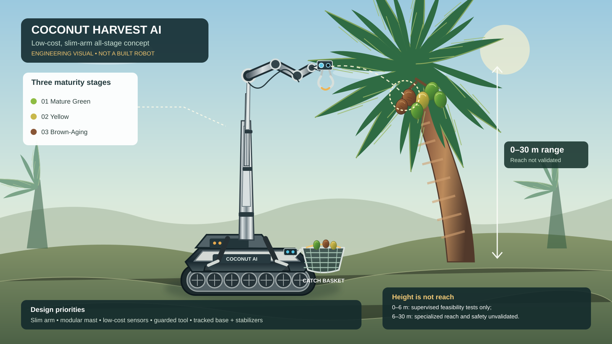

# Coconut Harvest AI

**การประเมินลักษณะความแก่ของมะพร้าวด้วยภาพ และสนับสนุนการวางแผนเก็บเกี่ยวโดยมีมนุษย์ตรวจสอบ**

[English](README.md) · [ภาษาไทย](README.th.md) · [เว็บไซต์ภาษาอังกฤษ](https://pui89.github.io/coconut.html) · [เว็บไซต์ภาษาไทย](https://pui89.github.io/coconut-th.html) · [PUI89 Portfolio](https://pui89.github.io/)

*ภาพประกอบแนวคิดเท่านั้น ไม่ใช่หลักฐานว่ามีการสร้างหุ่นยนต์หรือเก็บเกี่ยวได้สำเร็จ*

## 1. ผลิตภัณฑ์นี้คืออะไร

Coconut Harvest AI เป็นโครงการเกษตรที่ใช้ Computer Vision ช่วยผู้ดูแลสวนตรวจสอบลักษณะภายนอกของมะพร้าวจากภาพ และจัดเตรียมข้อมูลที่ตรวจสอบย้อนกลับได้เพื่อประกอบการวางแผนเก็บเกี่ยว ระยะแรกมุ่งพัฒนาซอฟต์แวร์ประเมินภาพ ส่วนหุ่นยนต์เก็บเกี่ยวจริงเป็นแนวทางวิจัยในอนาคต

**ผู้ใช้งาน:** เกษตรกร ผู้ดูแลสวนมะพร้าว และหน่วยงานด้านการเกษตร  
**ประโยชน์:** ช่วยตรวจสอบภาพ แบ่งกลุ่มลักษณะภายนอก และบันทึกความไม่แน่นอนเพื่อให้มนุษย์ตรวจทาน

## 2. ภารกิจและขอบเขตหน้าที่

- ตรวจสอบภาพมะพร้าวที่ผู้ใช้จัดเตรียมไว้ในเครื่อง พร้อมตรวจคุณภาพภาพและแหล่งที่มา
- ใช้กลุ่มลักษณะภายนอก 4 กลุ่ม ได้แก่ **เขียวอ่อน เขียวแก่ เหลือง และน้ำตาล**
- แยกการสังเกตสีออกจากการสรุปความแก่ทางชีวภาพและความเหมาะสมในการเก็บเกี่ยว ซึ่งต้องมีนิยามและการตรวจสอบโดยผู้เชี่ยวชาญ
- ส่งกรณีที่ไม่ชัดเจนหรือถูกบังให้มนุษย์ตรวจสอบ แทนการบังคับให้โมเดลทำนาย
- จัดทำบันทึกผลที่ตรวจสอบย้อนกลับได้เพื่อประกอบการวางแผน

## แนวคิดตัดหนึ่งครั้งต่อหนึ่งทะลาย และประเมินมะพร้าวคละระยะ (ข้อเสนอ)

**แนวคิดการออกแบบ:** ตัดทะลายมะพร้าวหนึ่งทะลายออกจากจุดยึดด้วยการตัดเพียงครั้งเดียว ทะลายเดียวกันอาจมีมะพร้าวแต่ละผลอยู่คนละระยะความแก่ ระบบจึงต้องประเมินทั้งทะลายและจำแนกมะพร้าวแต่ละผลแยกจากกัน ห้ามสมมติว่ามะพร้าวทุกผลในทะลายเดียวกันมีระยะความแก่เหมือนกัน

กลุ่มลักษณะภายนอก 4 กลุ่มที่เสนอ ได้แก่

1. **เขียวอ่อน (Young Green)**
2. **เขียวแก่ (Mature Green)**
3. **เหลือง (Yellow)**
4. **น้ำตาล (Brown)**

**ลำดับการทำงานที่ต้องการ**
- รับภาพจริงของทะลายที่มีมะพร้าวคละระยะ ทั้งก่อนและหลังตัด เมื่อได้ภาพมาอย่างปลอดภัยและมีสิทธิใช้งาน
- ตรวจจับหรือแบ่งส่วนมะพร้าวแต่ละผลภายในทะลายเดียวกัน เก็บรหัสทะลายร่วมกัน และกำหนดคลาสรายผล พร้อมค่าความเชื่อมั่น/ความไม่แน่นอนและสถานะที่ต้องตรวจทาน
- สรุปจำนวนมะพร้าวแยก 4 กลุ่มต่อทะลาย รวมถึงจำนวนศูนย์เมื่อไม่พบกลุ่มนั้น ผลที่ถูกบัง ซ้อนทับ เสียหาย หรือไม่ชัดเจนต้องส่งให้มนุษย์ตรวจสอบ
- ทดสอบโมเดล open-source ที่เป็น 후보บนชุดภาพจริงเดียวกัน ซึ่งตรวจสอบสิทธิและติดป้ายกำกับโดยมนุษย์ เปรียบเทียบ Precision, Recall และ F1 รายคลาส, confusion matrix, ความถูกต้องของจำนวนผล, การตรวจไม่พบ/ตรวจซ้ำ, การจัดการความไม่แน่นอน, เวลา inference และ RAM สูงสุด แบ่ง train/validation/test โดยป้องกัน data leakage และรายงานจำนวนตัวอย่างกับกรณีผิดพลาด
- **การตัดครั้งเดียวที่จุดยึดทะลาย** เป็นข้อกำหนดการออกแบบกลไกในอนาคต ต้องรองรับหรือยึดทะลายและควบคุมทิศทางการตกก่อนทดลองตัดทุกครั้ง การตัดต้องมีผู้ควบคุมดูแล เครื่องมือตัดมีการ์ดป้องกัน มี emergency stop และเข้าสู่สถานะปลอดภัยได้ ห้ามให้ผลจำแนกของ AI สั่งตัดเพียงลำพัง

**ข้อกำหนดด้านขนาดและรูปทรงที่หลากหลาย:** ต้องศึกษาและทดสอบทะลายที่มีขนาด รูปร่าง ขนาดผล ทิศทางทะลาย รูปทรงก้าน/ขั้ว มุมกล้อง แสง และการบังแตกต่างกัน คำว่า “ทุกมิติ” เป็นเป้าหมายการออกแบบที่ต้องกำหนดขอบเขตและทดสอบ ไม่ใช่การกล่าวอ้างว่าชุดตัดหรือโมเดลหนึ่งแบบรองรับทุกขนาดได้แล้ว

**สถานะหลักฐาน:** เป็นแนวคิดและแผนการตรวจสอบที่เสนอเท่านั้น ผู้ใช้จะนำภาพจริงมาใช้ทดสอบ ยังไม่มีผล benchmark จากภาพจริง ไม่มีโมเดลที่ยืนยันว่าดีที่สุด ไม่มีค่าความแม่นยำสำหรับทะลายคละระยะ และยังไม่มีหลักฐานว่ากลไกตัดครั้งเดียวรองรับทุกมิติหรือทำงานเก็บเกี่ยวจริงได้อย่างปลอดภัย ห้ามเผยแพร่อันดับโมเดลหรือตัวเลขสมรรถนะก่อนทดสอบซ้ำได้จริง

## 3. ผู้ใช้งานและคุณค่าที่มุ่งส่งมอบ

ช่วยให้ผู้ปฏิบัติงานมีข้อมูลจากภาพและบันทึกผลการประเมินที่ตรวจสอบย้อนหลังได้ โดยไม่แทนที่การตัดสินใจของเกษตรกรหรือผู้เชี่ยวชาญ

## 4. ความสามารถเฉพาะผลิตภัณฑ์

ขอบเขตระยะแรกคือการประเมินภาพด้วยซอฟต์แวร์ การตรวจจับ/แบ่งส่วนภาพอาจได้รับการประเมินตามความเหมาะสม ส่วน Object Tracking, VLM และโมเดลพยากรณ์เป็นความสามารถที่อาจพิจารณาเมื่อมีข้อมูลที่ได้รับอนุญาตและผ่านการตรวจสอบแล้ว

## 5. AI และสถาปัตยกรรมความฉลาด

ความสามารถที่อาจใช้ ได้แก่ Object Detection, Image Segmentation, Object Tracking และ VLM สำหรับการทบทวนโดยมนุษย์ ทั้งหมดเป็นแนวทางจัดสรรเทคโนโลยี ไม่ใช่หลักฐานว่ามีการติดตั้งหรือผ่านการทดสอบแล้ว กรอบความสามารถร่วมและข้อกำหนดด้านหลักฐานอยู่ใน [PUI89 Shared AI Core](https://github.com/Pui89/PUI89-Shared-AI-Core).

## 6. ฮาร์ดแวร์และเซนเซอร์

ระยะแรกเป็นซอฟต์แวร์ประเมินภาพ ยังไม่มีการยืนยันว่ามีหุ่นยนต์เก็บเกี่ยว กล้องเชิงลึก หรือระบบเซนเซอร์ที่ติดตั้งและทำงานร่วมกันแล้ว ขนาด น้ำหนัก น้ำหนักบรรทุก ระยะเอื้อม และความสามารถจัดการผลผลิตยังเป็น TBD

## 7. ความปลอดภัย ความเป็นส่วนตัว และความมั่นคงปลอดภัย

ใช้ภาพที่ผู้ใช้มีสิทธิ์ใช้งานและเก็บข้อมูลต้นทางให้ตรวจสอบได้ ภาพสวนที่ผู้ใช้ส่งมาต้องอยู่ในเครื่อง เว้นแต่ได้รับอนุญาตให้ส่งออกอย่างชัดเจน ระบบในอนาคตต้องมีการควบคุมความเป็นส่วนตัวและการตรวจสอบโดยมนุษย์ตามมาตรฐาน Shared AI Core

## 8. สิ่งที่ยังไม่มีหลักฐานยืนยัน

- ยังไม่มีชุดข้อมูลฝึกจากสวนจริงที่ผ่านการอนุมัติสิทธิ์และรายงานความแม่นยำจากชุดทดสอบแยก
- ระยะ 0–30 เมตรเป็นความท้าทายการวิจัยระยะยาว ไม่ใช่ระยะตรวจจับหรือระยะเอื้อมที่ผ่านการยืนยัน
- ยังไม่มีระบบปีนต้นไม้ ตัดทะลาย เก็บเกี่ยวอัตโนมัติ หรือหลักฐานความปลอดภัยภาคสนาม
- ภาพแนวคิดหรือการทดสอบซอฟต์แวร์ไม่ใช่หลักฐานสมรรถนะการเก็บเกี่ยว

## 9. สถานะการพัฒนาและหลักฐาน

**Implemented — พื้นฐานซอฟต์แวร์และการเตรียมการประเมิน** สถานะนี้หมายถึงงานซอฟต์แวร์เท่านั้น ไม่ได้หมายความว่ามีหุ่นยนต์เก็บเกี่ยวจริง

## ตอนนี้กำลังพัฒนาอะไร — 25 พฤศจิกายน 2026

**จุดเน้นปัจจุบัน: พิสูจน์ระบบ AI Vision ก่อนสร้างฮาร์ดแวร์เก็บเกี่ยว** ระยะปัจจุบันยังเป็นต้นแบบซอฟต์แวร์แบบ Local-first และการเตรียมหลักฐาน ยังไม่กล่าวอ้างว่ามีโมเดลตรวจจับมะพร้าวที่ฝึกเสร็จ โมเดลจำแนก 4 ระยะที่ผ่านการทดสอบ หรือหุ่นยนต์เก็บเกี่ยวที่ทำงานได้จริง

### งานที่กำลังดำเนินการ
1. **หลักฐานชุดข้อมูล:** รวบรวมแหล่งภาพมะพร้าวที่เป็นผู้สมัคร และตรวจสอบที่มาของไฟล์ ใบอนุญาต/การอนุญาต และขอบเขตการใช้งานก่อนรับภาพเข้าชุดข้อมูล
2. **ป้ายกำกับที่มนุษย์ตรวจสอบ:** กำหนดและตรวจทาน 4 กลุ่มลักษณะภายนอก ได้แก่ เขียวอ่อน เขียวแก่ เหลือง และน้ำตาล โดยแยกสีที่มองเห็นออกจากความแก่ทางชีวภาพและความเหมาะสมในการเก็บเกี่ยว
3. **คุณภาพชุดข้อมูล:** ตรวจรูปทรง annotation ภาพซ้ำ และการแบ่งชุดข้อมูลเพื่อป้องกัน data leakage โดยจัดกลุ่มตามสวน/ต้นไม้/รอบการถ่ายภาพ
4. **AI Baseline ที่ทำซ้ำได้:** เมื่อผ่านเกณฑ์ข้อมูลแล้ว จึงประเมินโมเดล Vision แบบ Open-source บนเครื่องด้วย CPU และรายงาน Precision, Recall, F1 รายคลาส, Confusion Counts, จำนวนตัวอย่าง, กรณีผิดพลาด, เวลา และ RAM จนกว่าจะทดสอบจริงให้ระบุ Metrics ว่า NOT MEASURED
5. **ระบบช่วยตัดสินใจเก็บเกี่ยว:** คงการเลือกช่วงความแก่ การจัดการความไม่แน่นอน การตรวจสอบความปลอดภัย และการอนุมัติโดยมนุษย์ไว้ในระดับซอฟต์แวร์ช่วยตัดสินใจ ไม่มีคำสั่งควบคุมอุปกรณ์หรือคำสั่งตัดอัตโนมัติ

### ลำดับการทำงานของผลิตภัณฑ์ในอนาคต
รับภาพจากกล้อง/สวน → ตรวจคุณภาพภาพและที่มา → ตรวจจับมะพร้าว/ทะลาย → ประเมินมะพร้าวแต่ละผลเป็น 4 กลุ่ม → ผู้ใช้เลือก **Selective Harvest (เลือกเก็บเฉพาะระยะ)** หรือ **Mixed-Stage Harvest (เก็บหลายระยะ)** → ตรวจตำแหน่ง ระยะเอื้อม สิ่งกีดขวาง และความปลอดภัย → มนุษย์อนุมัติ → กลไกตัด/เก็บเกี่ยวในอนาคต → ตรวจผลและบันทึกหลักฐาน

ทะลายที่มีมะพร้าวคละระยะต้องประเมินแยกเป็นรายผล แนวคิดกลไกเสนอให้ตัดหนึ่งครั้งที่จุดยึดทะลาย โดยต้องรองรับทะลายก่อนปล่อยลงมา รูปแบบการรับผลผลิตในอนาคตอาจใช้ตะกร้า หรือปล่อยลงพื้นที่ที่ตรวจสอบแล้วว่าปลอดภัย ทั้งหมดนี้ยังเป็นข้อกำหนดการออกแบบ ไม่ใช่ความสามารถที่สร้างและทดสอบแล้ว

### ทิศทางวิจัยด้านหุ่นยนต์
แนวคิดระยะยาวคือรถเคลื่อนที่ในสวน พร้อมเซนเซอร์รับรู้สภาพแวดล้อม ระบบนำทาง แขนกล และกลไกตัดที่มีการ์ดป้องกันและรองรับทะลาย เป้าหมายความสูง **0–30 เมตร** เป็นโจทย์วิจัยระยะยาว โดยการมองเห็นทะลาย การเอื้อมถึงด้วยกลไก และการเก็บเกี่ยวอย่างปลอดภัยเป็นคนละปัญหาที่ต้องมีหลักฐานแยกกัน ปัจจุบันยังไม่มีการยืนยันช่วงความสูง การตัดอัตโนมัติ การใส่ตะกร้า หรือการทำงานในสวนจริง

**Gate ถัดไปทันที:** ตรวจสอบสิทธิ์/ที่มาของภาพและทำ annotation QA โดยมนุษย์ให้เสร็จ แช่แข็งการแบ่งชุดข้อมูลที่ป้องกัน data leakage จากนั้นจึงรันและเผยแพร่ผล AI Vision Benchmark บน CPU ที่ทำซ้ำได้ ห้ามเริ่มทดลองเก็บเกี่ยวจริงจนกว่าจะมีการกำหนดภารกิจ ออกแบบวิศวกรรม วิเคราะห์อันตราย และอนุมัติแผนทดสอบที่มีผู้ควบคุมแยกต่างหาก

## ความคืบหน้าที่ตรวจสอบได้ล่าสุด — 24 พฤศจิกายน 2026

งานล่าสุดช่วยเสริมพื้นฐานด้านหลักฐานและการตรวจสอบภาคสนาม เป็นความคืบหน้าด้านเอกสารและเครื่องมือซอฟต์แวร์ ไม่ใช่หลักฐานว่ามีโมเดลที่ฝึกเสร็จหรือหุ่นยนต์เก็บเกี่ยวที่ทำงานได้จริง

- **การป้องกันข้อมูลรั่วไหลระหว่างชุดข้อมูล:** รวม validator และ tests สำหรับตรวจการแยกกลุ่มตาม orchard, tree, capture session และ near-duplicate metadata การตรวจนี้ไม่ได้ยืนยันสิทธิภาพ คุณภาพป้ายกำกับ หรือความแม่นยำโมเดล ดู [เกณฑ์คุณภาพชุดข้อมูล](docs/COCONUT_DATASET_QUALITY_GATE_V0_2.md)
- **การค้นหาแหล่งภาพสาธารณะ:** บันทึกแหล่งข้อมูลที่เป็นผู้สมัคร 6 แหล่ง และจัดทำเอกสารตรวจสอบช่องทางเข้าถึง/ส่งออกไฟล์แยกต่างหาก ยังไม่มีการดาวน์โหลด archive หรือไฟล์ภาพ ดู [การตรวจสอบแหล่งชุดภาพ](docs/COCONUT_OPEN_DATASET_SOURCE_AUDIT_V1.0.md) และ [การตรวจสอบช่องทางเข้าถึง archive](docs/COCONUT_DATASET_ARCHIVE_ACCESS_REVIEW_V1.0.md)
- **Mendeley Coconut tree crown:** หน้า Dataset ระบุภาพ RGB 400 ภาพ ขนาด 512 × 512 และใบอนุญาต CC BY 4.0 แต่ยังไม่ได้ดึงหรือตรวจ archive เอกสารวิจัยที่เชื่อมโยงรายงานจำนวนต่างออกไปคือ 900 ภาพ ความแตกต่างนี้ยังไม่คลี่คลาย ห้ามนำจำนวนมารวมกัน
- **CRipS:** บทความวิจัยรายงานชุดภาพ RGB จากสวนมะพร้าวประมาณ 500 ภาพ แต่ยังยืนยันไม่ได้ว่ามี archive สาธารณะให้ดาวน์โหลดและมีใบอนุญาตนำกลับมาใช้หรือไม่ จึงยังไม่อนุมัติให้ใช้ฝึกโมเดล
- **การเตรียมตรวจสอบภาคสนามในประเทศไทย:** รวม [ทะเบียนหลักฐานภาคสนาม G0](docs/COCONUT_G0_EVIDENCE_REGISTER.md) ซึ่งเป็นแบบฟอร์มเปล่าสำหรับการสำรวจสวน กระบวนการทำงาน และโรงคัด/แปรรูป ยังไม่มีการสัมภาษณ์ การวัดภาคสนาม หรือการยืนยันลูกค้า

**ขอบเขตหลักฐานปัจจุบัน:** ยังไม่มีชุดภาพสวนจริงที่ผ่านการอนุมัติสิทธิ์ ไม่มีการอนุมัติสิทธิ์ภาพรายไฟล์ ไม่มีป้ายกำกับ 4 กลุ่มที่มนุษย์ตรวจครบ ไม่มีโมเดล PUI89 ที่ฝึกและประเมินแล้ว ไม่มีค่าความแม่นยำจากชุดทดสอบแยก และไม่มีผลยืนยันการเก็บเกี่ยวจริง การอัปเดตครั้งนี้ไม่มีการดาวน์โหลดไฟล์

**Gate ถัดไป:** ตรวจไฟล์ต้นทางและเงื่อนไขใบอนุญาตโดยไม่หลีกเลี่ยงข้อจำกัดการเข้าถึง ปรับ mapping ระหว่างคลาสภาพสาธารณะ 4 กลุ่มกับ schema ภายใน จากนั้นจึงทำ annotation/QA โดยมนุษย์และแบ่งชุดข้อมูลแบบป้องกัน data leakage ก่อนประเมินบน CPU อย่างทำซ้ำได้

## 10. ขั้นตอนพิสูจน์ผลถัดไป

ตรวจสอบสิทธิ์และที่มาของภาพ จัดทำแนวทางติดป้ายกำกับและ QA แบ่งชุดข้อมูลโดยป้องกัน data leakage จากนั้นประเมินบน CPU อย่างทำซ้ำได้ รายงาน Precision, Recall, F1 รายคลาส จำนวนตัวอย่าง confusion counts กรณีผิดพลาด เวลาในการประมวลผล และ RAM เฉพาะเมื่อรันทดสอบจริงแล้ว

## 11. การเชื่อมต่อกับ Shared AI Core

ข้อกำหนดสถาปัตยกรรม สัญญาข้อมูล หลักฐาน ความปลอดภัย ความเป็นส่วนตัว และการกู้คืนใช้มาตรฐานร่วมจาก [PUI89 Shared AI Core](https://github.com/Pui89/PUI89-Shared-AI-Core) ส่วนงานเกษตรและเกณฑ์ประเมินมะพร้าวยังคงเป็นข้อกำหนดเฉพาะผลิตภัณฑ์

## 12. เอกสารและลิงก์โครงการ

- [ข้อกำหนดตลาดและวิศวกรรมเพื่อการลดแรงงาน (เอกสารภาษาอังกฤษ)](docs/COCONUT_LABOUR_REDUCTION_MARKET_REQUIREMENTS.md) — กลุ่มลูกค้า ตลาดเป้าหมาย การสำรวจภาคสนาม ตัวชี้วัด และ Gate การพัฒนา
- [ทะเบียนหลักฐานภาคสนาม G0 ประเทศไทย](docs/COCONUT_G0_EVIDENCE_REGISTER.md) — แบบฟอร์มเปล่าสำหรับบันทึกสวน โรงงาน การสัมภาษณ์ ค่าฐานการทำงาน KPI และการตรวจสอบหลักฐาน

- [ข้อกำหนดผลิตภัณฑ์ Software MVP](docs/COCONUT_SOFTWARE_MVP_PRODUCT_SPEC.md)
- [เกณฑ์การดำเนินการตรวจสอบภาพจริง](docs/COCONUT_REAL_IMAGE_VALIDATION_EXECUTION_GATES.md)
- [แผนตรวจสอบ 4 กลุ่มและโจทย์ 0–30 เมตร](docs/FOUR_CLASS_0_30M_VALIDATION_ROADMAP.md)
- [ข้อกำหนดความแก่ ตำแหน่ง และการเก็บเกี่ยว](docs/COCONUT_MATURITY_LOCATION_HARVEST_REQUIREMENTS.md)

**PUI89 มีผลิตภัณฑ์ที่ active 6 ผลิตภัณฑ์เท่านั้น** Shared AI Core เป็นโครงสร้างพื้นฐานร่วม ไม่ใช่ผลิตภัณฑ์ลำดับที่ 7

สถานะความพร้อมและการกล่าวอ้างทุกอย่างต้องอ้างอิงหลักฐานที่ตรวจสอบได้ ห้ามนำตัวเลขหรือสมรรถนะที่ยังไม่ได้วัดมาเผยแพร่

## วิศวกรรมและการผลิตระดับสากล

ดู [PUI89 Global Engineering & Manufacturing Design Brief](docs/PUI89_GLOBAL_MANUFACTURING_DESIGN_BRIEF_V1.0.md) สำหรับข้อกำหนดเบื้องต้นด้านขนาด วัสดุประเภทที่อยู่ระหว่างศึกษา กลุ่มส่วนประกอบ การผลิตหลายประเทศ การทดสอบสภาพแวดล้อม และเกณฑ์การตรวจสอบ เอกสารนี้แยกเป้าหมายการออกแบบออกจากผลทดสอบจริง รายการวัสดุและส่วนประกอบยังไม่ใช่ BOM ที่อนุมัติผลิต ขนาด เกรดวัสดุ รุ่นชิ้นส่วน และค่าความคลาดเคลื่อนที่ยังไม่มีหลักฐานจะระบุเป็น TBD จนกว่าจะผ่านการวิเคราะห์และการตรวจสอบทางวิศวกรรม

## ระบบวิศวกรรมและการผลิตระดับสากล

สำหรับวิศวกร โรงงาน และผู้ปฏิบัติงานในทุกประเทศ ให้ใช้งานเอกสารควบคุมกลางของ PUI89:
- [พอร์ทัลวิศวกรรมและการผลิต PUI89](https://pui89.github.io/global-engineering.html)
- [PUI89 Global Manufacturing Handoff System v1.0](https://github.com/Pui89/Pui89.github.io/blob/main/docs/PUI89_GLOBAL_MANUFACTURING_HANDOFF_SYSTEM_V1.0.md)

**กฎการผลิต:** ซื้อ ผลิต เปลี่ยนชิ้นส่วน ตรวจสอบ หรืออนุมัติผลิตภัณฑ์ได้เฉพาะตาม configuration, revision, drawing, BOM และ work instruction ที่อนุมัติแล้วเท่านั้น หากข้อมูลขาดหายหรือขัดแย้ง ให้ **หยุดงาน — ห้ามเดา** และเปิด Technical Query (TQ) ชุดแบบฟอร์มการผลิตกลางกำลังตรวจสอบใน [PUI89 website PR #639](https://github.com/Pui89/Pui89.github.io/pull/639) และยังไม่ใช่เอกสารอนุญาตให้ผลิต

## นโยบายเทคโนโลยีพร้อมรับอนาคต

ผลิตภัณฑ์นี้ยึดแนวทางตาม [นโยบายเทคโนโลยีพร้อมรับอนาคตของ PUI89 v1.0](https://github.com/Pui89/PUI89-Shared-AI-Core/blob/main/docs/architecture/PUI89_FUTURE_READY_TECHNOLOGY_POLICY_V1.0.th.md) ซึ่งกำหนดให้ออกแบบอินเทอร์เฟซที่อัปเกรดได้ เลือกเทคโนโลยีจากหลักฐาน ตรวจสอบแหล่งที่มา/ใบอนุญาต ควบคุมทรัพยากรแบบ Local-first ทดสอบความเข้ากันได้ มีระบบสำรองที่ปลอดภัย และควบคุมขอบเขตการส่งมอบ โดยติดตามเทคโนโลยีทุกเดือนและทบทวนสถาปัตยกรรมทุกไตรมาส การเพิ่มลิงก์นี้เป็นการอ้างอิงนโยบาย ไม่ได้ยืนยันว่ามีการสลับโมเดล Hardware Abstraction, Sensor Adapter ระบบติดตามอัตโนมัติ หรือการตรวจสอบผลิตภัณฑ์แล้ว

## แผนอัปเกรดเทคโนโลยีเฉพาะผลิตภัณฑ์

**ความสอดคล้องกับ Gartner 2026:** Physical AI, Domain-Specific Language Models, Hybrid/AI Supercomputing และ Digital Provenance ดู [นโยบายกลางของ PUI89](https://github.com/Pui89/PUI89-Shared-AI-Core/blob/main/docs/architecture/PUI89_FUTURE_READY_TECHNOLOGY_POLICY_V1.0.th.md)

| ด้านที่อัปเกรด | ลำดับแผน (ยังไม่ใช่การยืนยันความสามารถ) |
|---|---|
| Vision และ Multimodal AI | ตรวจสอบสิทธิ์และที่มาภาพ สร้าง RGB Baseline ที่ทำซ้ำได้ วัด Detection/Classification/Segmentation และประเมิน Multimodal Fusion เมื่อช่วยการตัดสินใจด้านพืชจริง |
| แผนที่สวน 3D/Multi-view | กำหนดกรณีใช้งานและสัญญาข้อมูล/พิกัด ประเมิน Multi-view/Depth หลังมี RGB Baseline และใช้ 3D ต่อเมื่อประโยชน์คุ้มกับทรัพยากรและเซนเซอร์ |
| Edge AI | วัด Inference บน CPU, หน่วยความจำ, Latency, พลังงานและความร้อน พร้อมแยก Model/Runtime ให้เปลี่ยนได้และมีระบบสำรอง |
| ผู้ช่วยความรู้เฉพาะพืช | พิจารณาผู้ช่วยที่มีขอบเขต อ้างอิงแหล่งข้อมูล และให้มนุษย์ตรวจสอบ ห้ามให้คำแนะนำเกษตรที่ไม่มีหลักฐาน |

**Gate แรก:** สิทธิ์/ที่มาข้อมูล ป้ายกำกับที่มนุษย์ตรวจสอบ Metrics ที่ทำซ้ำได้ และ Baseline ทรัพยากร **สถานะ:** แผนที่เสนอเท่านั้น

## แผนวิวัฒนาการเทคโนโลยีระยะยาวและการป้องกันความล้าสมัย (2027–2030+)

แผนระยะยาวนี้ต่อยอดจากลำดับพัฒนา P1–P4 และขยายกรอบคิดจากแนวโน้มปี 2026 ไปข้างหน้า โดยเป็นช่วงเวลาสำหรับประเมิน ไม่ใช่การรับประกันความสามารถหรือกำหนดวันนำมาใช้ เทคโนโลยีทุกชนิดต้องผ่านการพิสูจน์คุณค่าต่อผู้ใช้ ที่มาและใบอนุญาต ความเหมาะสมกับฮาร์ดแวร์ ความปลอดภัย การบำรุงรักษา และหลักฐานที่ทำซ้ำได้

| ช่วงเวลา | แนวทางวิวัฒนาการของผลิตภัณฑ์ |
|---|---|
| 2027 | กำหนดอินเทอร์เฟซ Vision/Model ที่เปลี่ยนได้ ตรวจสอบที่มาชุดข้อมูล สร้าง RGB Baseline ที่ทำซ้ำได้ และวัด Edge Inference แบบ CPU-first |
| 2028 | ประเมิน Multimodal/Multi-view Perception, แผนที่สวน Depth/3D และโมเดลขนาดเล็กเฉพาะพืช เฉพาะเมื่อมีประโยชน์ภาคสนามคุ้มกับเซนเซอร์และ Compute ที่เพิ่มขึ้น |
| 2029 | สำรวจ Spatial/Temporal Orchard Intelligence, การติดตามสถานะพืชตามเวลา และระบบช่วยตัดสินใจที่อ้างอิงหลักฐานพร้อมผู้เชี่ยวชาญเกษตรตรวจสอบ |
| 2030+ | รักษาความสามารถในการย้าย Model, Sensor และ Edge Hardware พัฒนาไปสู่ Precision Orchard โดยไม่ผูกกับผู้ขายโมเดลหรือเซนเซอร์รุ่นเดียว |

**กฎป้องกันความล้าสมัยอย่างต่อเนื่อง:** ติดตามสัญญาณเทคโนโลยีทุกเดือน ทบทวนสถาปัตยกรรมทุกไตรมาส และทบทวน Roadmap ทั้งหมดทุกปี พร้อมทบทวนนอกกำหนดเมื่อ Dependency สำคัญหยุดสนับสนุน พบปัญหาความปลอดภัย หรือผลทดสอบเกินข้อจำกัดด้านประสิทธิภาพ/ทรัพยากร ทุกการอัปเกรดต้องมี Baseline ที่ตรวจสอบแล้ว แผน Migration/Rollback ชุดทดสอบ Compatibility/Regression และบันทึกเหตุผลการตัดสินใจ ห้ามเลือกเทคโนโลยีเพียงเพราะเป็นของใหม่ **สถานะ:** เป็นแผนที่เสนอ ยังไม่กล่าวอ้างว่าความสามารถในอนาคตถูกพัฒนาหรือ Validate แล้ว

---

## ทิศทางการวิจัยทางวิชาการ — เป้าหมายวารสาร Q1 (ข้อเสนอ)

**หัวข้อวิจัย:** Multimodal Vision AI สำหรับประเมินความแก่ของมะพร้าวและความพร้อมในการเก็บเกี่ยว  
**ชื่อบทความเบื้องต้น:** *Temporal, Occlusion-Aware Multimodal Vision for Uncertainty-Calibrated Coconut Maturity Assessment under Orchard Conditions*

**สถานะ:** ข้อเสนอเพื่อให้อาจารย์พิจารณา ยังไม่ได้ยืนยันช่องว่างงานวิจัย ความใหม่ วิธีทดลอง สิทธิ์ข้อมูล หรือผลการทดลอง และไม่ได้กล่าวอ้างว่าได้รับการตีพิมพ์ Q1 แล้ว

### 1. ปัญหาและความสำคัญ

ภาพ RGB เพียงภาพเดียวอาจไม่เพียงพอในการจำแนกความแก่ของมะพร้าวอย่างน่าเชื่อถือ เนื่องจากผลซ้อนทับกัน ถูกบัง แสงเปลี่ยน ระยะกล้องต่างกัน พันธุ์และสภาพสวนแตกต่างกัน รวมถึงสีภายนอกอาจไม่ตรงกับความแก่ทางชีวภาพ งานวิจัยจะศึกษาว่าการใช้ภาพหลายช่วงเวลา/หลายมุมมองและข้อมูลเรขาคณิตที่มีจริงช่วยได้หรือไม่ พร้อมระบุกรณีที่หลักฐานไม่เพียงพอ

คง 4 กลุ่มเดิม: **เขียวอ่อน, เขียวแก่, เหลือง และน้ำตาล** โดยต้องให้นักวิชาการเกษตรกำหนด Ground Truth และกรณีก้ำกึ่ง สีภายนอกไม่ควรถูกใช้แทนความแก่ทางชีวภาพหรือความเหมาะสมในการเก็บเกี่ยวโดยอัตโนมัติ

### 2. ช่องว่างที่ต้องตรวจสอบ

- การทดสอบข้ามต้นไม้ รอบการถ่ายภาพ และสวนที่แยกจากกันยังต้องตรวจสอบ
- ผลกระทบจากการบังผล มะพร้าวต่างระยะในทะลายเดียวกัน แสง และมุมกล้อง
- การประเมินความมั่นใจและการงดทำนายเมื่อข้อมูลไม่เพียงพอ
- ความเชื่อมโยงระหว่างภาพกับการประเมินโดยผู้เชี่ยวชาญและความเหมาะสมในการเก็บเกี่ยว

### 3. คำถามและสมมติฐานวิจัย

- RQ1 ภาพหลายช่วงเวลาหรือหลายมุมมองช่วยเพิ่มความแม่นยำจากภาพ RGB ภาพเดียวหรือไม่
- RQ2 ข้อมูล Depth/Geometry ที่สอบเทียบแล้วช่วยในกรณีถูกบังหรือระยะต่างกันหรือไม่
- RQ3 การประเมิน Uncertainty และส่งให้มนุษย์ตรวจช่วยลดความผิดพลาดได้หรือไม่
- H1 การใช้ข้อมูลหลายมุมมอง/หลายช่วงเวลาจะเพิ่มผลการจำแนกบนต้นไม้หรือสวนที่ไม่อยู่ในชุดฝึก
- H2 ระบบที่รู้จักความไม่แน่นอนจะจัดการกรณีกำกวมได้ดีกว่าการบังคับทำนายทุกภาพ

### 4. วิธีการแบบ Hybrid AI

1. ตรวจสอบสิทธิ์ ที่มา และ Metadata ของภาพ
2. ใช้โมเดล Detection/Instance Segmentation เพื่อระบุผลมะพร้าว
3. เปรียบเทียบ CNN, Vision Transformer และ Foundation Model ที่ตรวจสอบที่มาและใบอนุญาตแล้ว
4. เชื่อมโยงภาพหลายช่วงเวลาหรือหลายมุมมองของผล/ทะลายเดียวกัน
5. เพิ่ม Depth/Geometry เฉพาะเมื่อมีข้อมูลที่สอบเทียบได้จริง
6. ประเมิน Calibration, Uncertainty และ Abstention
7. แสดงผลรายผลและรายทะลาย พร้อมสถานะให้มนุษย์ตรวจ โดย AI ไม่มีสิทธิ์สั่งตัดหรือเก็บเกี่ยวอัตโนมัติ

### 5. ชุดข้อมูลที่เสนอ

- ข้อมูลภาพ/วิดีโอจากสวนมะพร้าวที่ได้รับอนุญาต พร้อมข้อมูลต้น ทะลาย ผล วันที่ รอบถ่าย กล้อง แสง มุม และระดับการบัง
- ป้ายกำกับ 4 กลุ่มที่ผู้เชี่ยวชาญตรวจสอบ พร้อมวิธีตัดสินกรณีก้ำกึ่ง
- AmodalAppleSize RGB-D อาจใช้เปรียบเทียบวิธีด้านผลไม้และ Geometry ได้ แต่ไม่ใช่ Ground Truth ของมะพร้าว
- แหล่งภาพมะพร้าวสาธารณะต้องตรวจสอบไฟล์จริง ใบอนุญาต ที่มา และความเหมาะสมก่อนอนุมัติ

### 6. การทดลองและตัวชี้วัด

- เปรียบเทียบ Baseline แบบง่าย, CNN, Detector/Classifier และ Transformer
- ทดลองภาพเดียวเทียบกับภาพหลายช่วงเวลา/หลายมุม
- ทดลอง RGB เทียบกับ RGB+Depth ที่สอบเทียบแล้ว
- แยกทดสอบการบัง แสง ระยะ และทะลายที่มีมะพร้าวหลายระยะ
- ทดสอบ Calibration และการส่งกรณีไม่แน่นอนให้มนุษย์
- แบ่งชุดข้อมูลตามต้นไม้ รอบถ่าย และสวน พร้อมวัด Latency, RAM และ Model Size

**ผลหลัก:** กำหนด Macro-F1 หรือ Balanced Accuracy ล่วงหน้า พร้อม Precision/Recall รายกลุ่ม  
**ผลรอง:** ความผิดพลาดในการนับผล, Brier Score, Reliability Diagram, Risk-Coverage, Latency และ RAM

### 7. ผลงานทางวิทยาศาสตร์ที่คาดหวัง

วิธีประเมินความแก่มะพร้าวที่ใช้ข้อมูลหลายช่วงเวลา/หลายมุมมอง คำนึงถึงการบัง และประเมินความไม่แน่นอน พร้อม Protocol ที่ทำซ้ำได้และแสดงให้เห็นว่าเมื่อใดการเพิ่ม Sensor ช่วยหรือไม่ช่วย

### 8. เงื่อนไขการตรวจสอบ

ป้องกัน Data Leakage ระหว่างต้น ทะลาย รอบถ่าย และสวน รายงานจำนวนตัวอย่าง ความสอดคล้องของผู้ติดป้ายกำกับ ช่วงความเชื่อมั่น และ Failure Cases ตรวจสอบการอนุญาตใช้พื้นที่และความเป็นส่วนตัวก่อนเก็บข้อมูล การส่ง Q1 ต้องผ่านการตรวจสอบความใหม่และหลักฐานจากงานทดลองจริง

## 360° Intelligence

เพิ่มข้อกำหนดการมองหลายมุมรอบต้นมะพร้าวและทะลาย เพื่อช่วยเชื่อมโยงภาพ ตรวจจับผลซ้ำ และประเมินผลมะพร้าวรายลูก โดยต้องมีแหล่งที่มาภาพ การตรวจสอบโดยมนุษย์ และการจัดการส่วนที่ถูกบัง ดู [360° Intelligence Profile v1.0](docs/PUI89_360_DEGREE_INTELLIGENCE_PROFILE_V1.0.md) และ [สถาปัตยกรรมกลาง](https://github.com/Pui89/PUI89-Shared-AI-Core/blob/main/docs/PUI89_360_DEGREE_INTELLIGENCE_V1.0.md) **สถานะ: Proposed** ยังไม่มีระบบกล้อง 360° หรือผลทดสอบภาคสนามที่ยืนยันแล้ว
